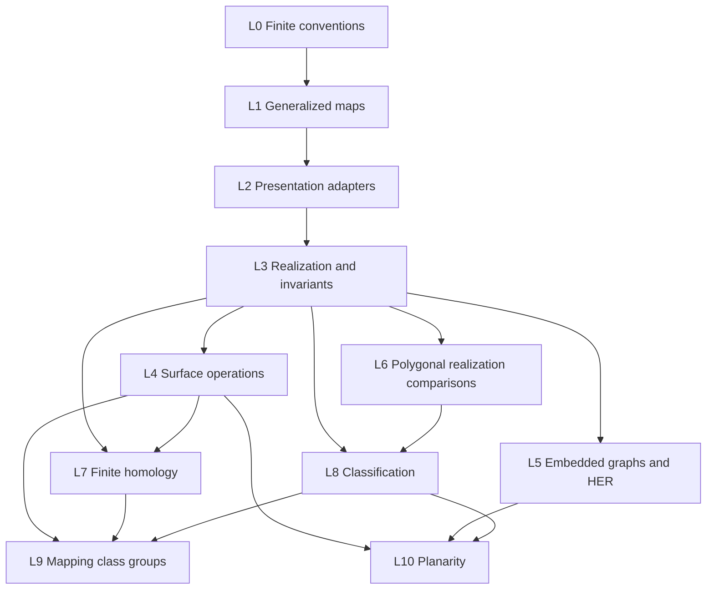

# Roadmap: Surface topology, finite presentations, and classification

A compact surface admits several finite combinatorial descriptions. A triangulation presents it as finitely many triangles with edge identifications.  A generalized map records the same incidence data by three involutions on a finite set of darts. This roadmap proves that the finite and topological descriptions determine one another, develops the finite invariants and moves, and derives the classification of compact surfaces.

The classification supplies `GeometricTopology`'s surface input, including the closed
orientable surfaces used in Heegaard splittings. Its proof uses finite triangles, polygon
moves, and explicit Euler-characteristic calculations. Existence comes from the polygonal
normal forms; uniqueness comes from `V - E + F`, orientability, and boundary count, whose
topological invariance is supplied by `PlanarTopology`. The classification proof does not
use homology. Layer 7 develops classical homology from finite boundary matrices, with
topological invariance proved through subdivision and equivalence of triangulations;
layer 9 uses the resulting invariants and induced maps.

The summits reached by this roadmap are:

1. **The realization theorem**: every finite generalized map realizes as a compact surface, the orbit cells of a surface map are the cells of that surface, and every compact surface has a presentation as a generalized map.
2. **The Heffter–Edmonds–Ringel theorem**: cellular drawings of a finite graph in an oriented surface correspond to rotation systems, and in a general surface to signed rotation systems.
3. **The topological normal-form theorem**: the elementary polygon moves and normal forms of `FreeGroupsAndLimitGroups` induce homeomorphisms of generalized-map realizations, including surfaces with boundary.
4. **The classification of compact surfaces**: every compact connected surface, with or without boundary, is homeomorphic to exactly one standard model, determined by Euler characteristic, orientability, and number of boundary components.

Two later layers build on the core theory:

5. **Curves, cutting, and mapping class groups**: Dehn twists, the change-of-coordinates principle, and the Dehn–Lickorish generation theorem.
6. **Planarity**: Kuratowski, Whitney, Mac Lane, Fáry, and the five-colour theorem, as a theorem suite built on the map and embedding theory.

Layer 10 is a mathematical extension of the finite-map library and a test of it. It is not part of the proof of surface classification, and it is not a complete roadmap for graphs on surfaces.

Each layer below is organized around its principal theorem, mathematical dependencies, and proof route. The Lean declarations are representative interfaces: they expose the intended connections to Tau Ceti without replacing the mathematical statements.

---

## Relationship to other roadmaps

### Downstream consumers

| Consumer | What it needs | Where it is proved here |
|---|---|---|
| `GeometricTopology` layer 9 | the classification of closed orientable surfaces, for the splitting surface | layer 8 |
| `GeometricTopology` layer 9 | surface mapping classes | layer 9 |
| `BelyiMaps` | the surface of a dessin, from its permutation triple: its realization, its classification by genus, Euler's formula and Riemann–Hurwitz for it, and the rotation systems of its embedded dessin | layers 2, 3, 5, and 8 |
| a future Four Colour roadmap | plane maps, duality, Euler's formula, the five-colour theorem | layers 4, 5, and 10 |

The relationship with [BelyiMaps](../BelyiMaps/README.md) is a boundary, stated once. BelyiMaps owns dessins, passports, triangle groups, finite covers of the punctured sphere and their completion; this roadmap owns maps on surfaces in general, with boundary and non-orientability, their realization, and the classification. BelyiMaps' `PermutationTriple` is layer 2's hypermap presentation, used as it stands, and its `BipartiteRibbonGraph` is the dessin case of layer 2's oriented maps; layer 2 targets the conversions between the vocabularies and the agreement of the Euler characteristics.

### Exact supplier contracts

From [PlanarTopology](../PlanarTopology/README.md), at the following points:

| Item | Which layer here |
|---|---|
| `IsCombinatorialSurface`, its realization as a surface, `IsPLOn` and `IsPLMap` | 3, 5 |
| Radó: every compact surface is a finite combinatorial surface, with the boundary a subcomplex | 3, 8 |
| the two-dimensional Hauptvermutung and Pachner's theorem | 3, 7, 8 |
| `Surface.eulerChar`, `Surface.IsOrientable`, `Surface.Orientation`, and `boundaryComponentCount`, all homeomorphism invariants, with the boundary convention | 3, 5, 7, 8, 9, 10 |
| Schoenflies, tameness of arcs and simple closed curves, and tameness of finite families of arcs | 5, 9 |
| isotopy to a PL homeomorphism (layer 5) | 7, 9 |
| Epstein's theorem, the smoothing theorems, and isotopy to a diffeomorphism (layer 8) | 9 |

From [GraphConnectivityAndFlows](../GraphConnectivityAndFlows/README.md), which owns the connectivity and components of Mathlib's `Graph α β`:

| Item | Which layer here |
|---|---|
| `Graph.Connected`, in the shape of [Mathlib multigraph walks](https://github.com/leanprover-community/mathlib4/pull/37861), and its agreement with `SimpleGraph.Connected` across `Graph.ofSimpleGraph` (Target 1.1) | 5, 7, 10 |
| the number of connected components of a finite multigraph, written `Γ.componentCount` here (Milestone 2) | 10 |
| `SimpleGraph.IsVertexConnected k`, in the shape of [Mathlib vertex connectivity](https://github.com/leanprover-community/mathlib4/pull/33355) (conventions and Target 1.5) | 10 |
| the additional cut API and its incidence comparisons (Target 1.2), extending native `Graph.edgeCut` and `Graph.IsEdgeCut` | 10 |

From [FreeGroupsAndLimitGroups](https://github.com/TauCetiProject/TauCetiRoadmap/blob/main/TauCetiRoadmap/FreeGroupsAndLimitGroups/README.md), the following individual elementary inputs:

| Item | Which layer here |
|---|---|
| Serre darts and their native multigraph adapter (§§2.1–2.1a); signed path groups and spanning-tree presentations (§2.2) | 2, 7 |
| Integral and binary incidence kernels, forest bases, and their rank formulas (§2.2a) | 7, 10 |
| `PolygonalComplex`, connected `SurfaceModel`, corner links and boundary circuits (§6.0a) | 2, 4, 6 |
| `SurfaceModel.Move`, its finite equivalence closure, and handle/square normal forms with holes (§6.0b) | 6, 8 |
| Face presentations and their invariance, with marked boundary traversals (§6.0c) | 7 |
| Combinatorial two-sided curves, proper arcs, and their cut models (§6.0d) | 4, 9 |

These inputs are finite combinatorics and presented-group algebra. They require neither
abstract homology nor a topological classification theorem. Consume each item directly;
the rest of the group-theory programme is not a prerequisite. This roadmap owns the
adapters to generalized maps, the quotient realizations, the proofs that the shared moves
and cuts have the stated topological effect, and the classification of compact surfaces.

From the shared chain theories, by individual item:

| Item | Which layer here |
|---|---|
| The ordered-simplex chain complex in [GeometricTopology layer 11](https://github.com/TauCetiProject/TauCetiRoadmap/blob/main/TauCetiRoadmap/GeometricTopology/README.md#layer-11-triangulations-pl-structures-and-collapse), with its alternating boundary and simplicial maps | 7's finite simplicial input |
| The simplex CW structure and its ordered-boundary comparison in that same layer; general cellular chains and naturality in [AlgebraicTopology stage 4, items 1–3](https://github.com/TauCetiProject/TauCetiRoadmap/blob/main/TauCetiRoadmap/AlgebraicTopology/README.md#stage-4-cw-pairs-cellular-homology-and-cofibrations) | 7's separate cellular comparison |

The ordered-simplex algebra is the shared interface for finite chains. The explicit
surface boundary matrices, subdivision and contiguity chain homotopies, and the
comparison with generalized-map chains are targets here. The general cellular
comparison is a downstream bridge: the elementary invariance proof and the
classification do not use it. These supplier items do not use the surface
classification supplied to `GeometricTopology`.

From Tau Ceti and Mathlib:

| Item | Location |
|---|---|
| `Equiv.Perm`, orbits, `MulAction`, cycle types | Mathlib |
| `Cycle`, lists modulo rotation | `Mathlib/Data/List/Cycle.lean` |
| `AbstractSimplicialComplex`, `Realization`, `link`, subdivision, `SimplicialMap` | `TauCeti/AlgebraicTopology/SimplicialComplex/` |
| `IsTriangulable` | `TauCeti/Topology/Triangulable.lean` |
| structure theorem for finitely generated modules over a PID | `Mathlib.Algebra.Module.PID` |
| free groups, group presentations, `Subgroup.closure`, abelianization | Mathlib |
| `Isotopic`, `AmbientIsotopic` | `TauCeti/Topology/Homotopy/` |
| covering maps and path lifting, `IsCoveringMap`, `IsCoveringMap.liftPath` | Mathlib |
| the universal cover of the torus | `TauCeti/AlgebraicTopology/UniversalCover/` |
| the multigraph `Graph α β`: `IsLink`, `Inc`, `Adj`, `IsLoopAt`, `Simple`, `ofSimpleGraph`, `toSimpleGraph`, subgraphs, deletion | `Mathlib/Combinatorics/Graph/` |
| `SimpleGraph`, `completeGraph`, `completeBipartiteGraph`, `Colorable`, connectivity | `Mathlib/Combinatorics/SimpleGraph/` |
| `PermutationTriple` with `eulerChar` and `genus`; `BipartiteRibbonGraph` | `TauCeti/Combinatorics/PermutationTriple/`, `TauCeti/Combinatorics/RibbonGraph/Basic.lean`, owned by `BelyiMaps` |
| `Combinatorics/SimpleGraph/{Acyclic, BranchComponents, PathGraph}` | Tau Ceti |

Mathlib's `Graph α β` supplies incidence, subgraphs, `SimpleGraph` conversions, and
native cuts (`Graph.edgeCut` and `Graph.IsEdgeCut` in
`Mathlib/Combinatorics/Graph/Connected/EdgeCut.lean`). Connectivity and the component count of a multigraph, and `k`-vertex-connectivity of a simple graph, are GraphConnectivityAndFlows', shaped there after [Mathlib multigraph walks](https://github.com/leanprover-community/mathlib4/pull/37861) and [Mathlib vertex connectivity](https://github.com/leanprover-community/mathlib4/pull/33355); this roadmap defines no second connectivity or component theory. Degree, minors, and planarity are targets of layers 5 and 10, shaped after the linked Mathlib designs (degree by incidence counting and, for `SimpleGraph`, contraction and minors; [Mathlib graph degree](https://github.com/leanprover-community/mathlib4/pull/38326), [Mathlib graph contractions and minors](https://github.com/leanprover-community/mathlib4/pull/36210)), so that the eventual swap is a deletion.

`TauCeti/LinearAlgebra/Matrix/SmithNormalForm.lean` provides
`Matrix.exists_smith_normal_form_of_det_ne_zero` for nonsingular square integer
matrices, including negative determinant. General boundary matrices may be rectangular
or singular; use the PID structure theorem for their homology computations.


---

## Mathematical objects and formalization conventions

### A mathematical hub and several presentations

**The 2-dimensional generalized map is taken as the foundation.** A dart contains a complete flag, but also natively carries the side-incidence data that a face poset loses.  Boundary-ness is recorded by fixed points of the highest involution.  Non-orientability needs no signed variant.

Oriented maps, permutation triples (hypermaps), and polygonal schemas are **presentations**: each translates into the language of generalized maps and back, and each has its own natural operations. This roadmap does not propose a parallel realization theory. The topological realization and its comparison theorems are organized through generalized maps. Their cell counts, orientability and operations are compared to the shared polygonal definitions; the generalized-map chain complex is compared to the simplicial one. `BelyiMaps`' permutation triples are the hypermap presentation itself, consumed as they stand, and its bipartite ribbon graphs are a presentation of the dessin case; layer 2 records both.  This is deliberate, and it follows the discipline `GeometricTopology` layer 4 states for knot presentations: pick a hub, do not aim for the complete graph on presentations.

The comparison theorems in layer 2 are not a claim that all presentations are co-equal. They state precisely which information each conversion preserves and certify that the chosen hub represents the same finite surface data.

### Bundled index types and isomorphism closure

Every finite object bundles its own index type: darts for maps, vertices for complexes,
labels for polygonal presentations. An allowed step is either an isomorphism of the
bundled objects or an elementary move between isomorphic representatives. Apply
`Relation.ReflTransGen` to that combined relation. Thus relabelling alone is a valid
step, even when no elementary geometric move is available.

⚠ This is not cosmetic. The Pachner 1↔3 move adds a vertex and the schema cancellation move removes a letter, so both changes affect the index type. A relation on a fixed index type cannot express them, and `ReflTransGen` demands that intermediate index types line up on the nose.

### Realization

`GMap2.realization G` is defined **directly**, as the quotient of `D × Δ²` by the
side-gluings induced by the three involutions. It is always defined, with no hypotheses, and
this object carries the topology.

⚠ **The flag complex of a generalized map is not in general an abstract simplicial complex.**
Take the projective plane as the word `aa`, with one vertex, one edge, and one face. As a
generalized map on darts `{1,2,3,4}` with

```
α₀ = (1 2)(3 4)      α₁ = (1 4)(2 3)      α₂ = (1 3)(2 4)
```

the involutions `α₀` and `α₂` commute, so this is a valid 2-generalized map; all three orbit
groups act transitively, so there is one cell of each dimension and `χ = 1 - 1 + 1 = 1`. The
flag vertex set has three elements and admits exactly one triangle. However the four darts collapse to one simplex. The one-vertex torus fails in a similar way: eight darts, four flag vertices, two distinct triples.

The bridge to `AbstractSimplicialComplex` is therefore a **theorem about a subdivision**, not
a definition.  After the canonical barycentric subdivision of the map, the flag map is
injective and the flag complex is honest. One barycentric subdivision always suffices: a dart of the subdivided map is a flag of the flag complex, and its triple of cells contains the original dart as its face vertex, so the triple determines it. For the generalized map of a simplicial complex no subdivision is needed at all, since a dart is then a chain `v < e < t` and its triple is that chain. The `aa` map above is the certified counter-witness
recorded in layer 3's examples and mathematical checks.

### Euler characteristic

```lean
def GMap2.eulerChar (G : GMap 2 D) : ℤ :=
  (Nat.card (G.Cell 0) : ℤ) - Nat.card (G.Cell 1) + Nat.card (G.Cell 2)
```

with `Cell 0 = Orb⟨α₁,α₂⟩`, `Cell 1 = Orb⟨α₀,α₂⟩`, `Cell 2 = Orb⟨α₀,α₁⟩`.

**The boundary is recorded entirely by fixed points of `α₂`.** Boundary vertices and edges are already counted by the ordinary orbit cells. For a surface map in the sense of layer 1, a boundary edge has a two-element `⟨α₀,α₂⟩`-orbit and an interior edge a four-element one; this is the decidable boundary test. Without layer 1's third condition an interior edge can be folded onto itself, `α₂ d = α₀ d`, its orbit has two elements, and the orbit count is no longer the Euler characteristic of the realization: the map with two darts and all three involutions the swap realizes to a sphere and has orbit count 1.

### Invariance

**Invariance comes from the Hauptvermutung, not from comparison with singular theory.** Every invariant here is defined on a finite presentation and proved invariant under isomorphism, subdivision, and the elementary moves. `PlanarTopology`'s Radó, Hauptvermutung, and Pachner theorems then make it a homeomorphism invariant.

⚠ This roadmap does not contemplate a comparison theorem with Mathlib's `SingularHomology` or `FundamentalGroup`. None is needed: invariance of every finite invariant comes from the moves, and `PlanarTopology`'s Pachner theorem says the moves reach every triangulation of the same surface.

Consequently, ⚠ **the homology and fundamental group here are named for what they are.** Use `GMap2.homology` and `GMap2.edgePathGroup`, never bare `H₁` or `π₁`. A theorem reading `H₁_torus : H₁ T² ≅ ℤ × ℤ` would claim too much. When the comparison becomes available it will be a bridge theorem with two well-named sides.

---

## Dependencies



The supplier table above gives the individual PlanarTopology, graph, polygonal and
chain inputs. In particular, layer 7 is not an input to classification: layer 8
uses the geometric invariants from layer 3 and polygonal normal forms from layer 6.

---

## Layer 0: Finite conventions

This layer fixes the finite conventions: cyclic words are Mathlib's `Cycle`, and moves that change an object's indexing type go through bundling and isomorphism closure.

**Representative formal statements.**

```lean
-- Cyclic words are Mathlib's `Cycle α`: lists modulo rotation, repeated labels allowed, with its
-- decidable equality, membership, reversal, and length. No second quotient is built, and
-- `Cycle (label × Bool)` is the type of a face of a polygonal schema in layer 2. It has nothing to
-- do with `CircularOrder` or the topological circle.

structure BundledFinite where
  ι : Type
  fintype : Fintype ι
  decEq : DecidableEq ι

/-- s is the setoid of isomorphism of the bundled objects. -/
def isoClosure {X : Type*} (s : Setoid X) (r : X → X → Prop) : X → X → Prop :=
  fun a b => ∃ a' b', s.r a a' ∧ s.r b b' ∧ r a' b'

/-- An isomorphism is itself a step, even if r has no moves. -/
def moveStep {X : Type*} (s : Setoid X) (r : X → X → Prop) : X → X → Prop :=
  fun a b => s.r a b ∨ isoClosure s r a b

def moveSequence {X : Type*} (s : Setoid X) (r : X → X → Prop) : X → X → Prop :=
  Relation.ReflTransGen (moveStep s r)

theorem moveSequence_congr {X : Type*} (s : Setoid X) (r : X → X → Prop)
    {a a' b b' : X} (ha : s.r a a') (hb : s.r b b') :
    moveSequence s r a b ↔ moveSequence s r a' b'

/-- Equivalently, make isomorphisms and primitive moves separate steps. -/
theorem moveSequence_iff_iso_or_move {X : Type*} (s : Setoid X) (r : X → X → Prop)
    (a b : X) :
    moveSequence s r a b ↔ Relation.ReflTransGen (fun x y => s.r x y ∨ r x y) a b

theorem moveSequence_false_iff {X : Type*} (s : Setoid X) (a b : X) :
    moveSequence s (fun _ _ => False) a b ↔ s.r a b
```

**Proof strategy and formalization notes.** `Function.Involutive` and `Commute` in `Equiv.Perm D` are the Mathlib idioms; do not hand-roll `∀ d, f (f d) = d` or `f ∘ g = g ∘ f`.

**Examples and mathematical checks.** `Cycle` equality is Mathlib's decidable equality; that it distinguishes `abab` from `aabb` and identifies `abab` with `baba` is checked by `decide`.
For the move relation, check three cases with no geometric moves: an object reaches
itself; a triangle labelled `0,1,2` reaches its relabelled copy on `a,b,c`; a triangle
does not reach three isolated vertices, since those complexes are not isomorphic.
`moveSequence_false_iff` gives all three values. Also check an actual subdivision:
the changed vertex count excludes a pure isomorphism, but the elementary-move branch
allows the step. Isomorphisms preserve all specified extra data; in a relative
statement they preserve the prescribed boundary or subcomplex identification.
The relation keeps the direction of `r`; symmetry of a move equivalence uses inverse
moves, as included for the bistellar and shared polygonal calculi.

**Natural intermediate results.** (i) the shared cyclic traversal API; (ii) bundled
objects and their isomorphism setoids; (iii) the combined isomorphism/move relation,
its endpoint-congruence theorem, the separate-step characterization, and the
no-geometric-moves characterization.

---

## Layer 1: Generalized maps

The foundational object for all of the combinatorial topology which follows.

**Representative formal statements.**

```lean
structure GMap (n : ℕ) (D : Type*) [Fintype D] [DecidableEq D] where
  adj : Fin (n + 1) → Equiv.Perm D
  involutive : ∀ i, Function.Involutive (adj i)
  commute_of_far : ∀ i j, i.1 + 2 ≤ j.1 → Commute (adj i) (adj j)


abbrev GMap2 (D : Type*) [Fintype D] [DecidableEq D] := GMap 2 D

def GMap.Cell (G : GMap n D) (i : Fin (n + 1)) : Type* :=
  MulAction.orbitRel.Quotient (Subgroup.closure {G.adj j | j ≠ i}) D

structure GMap2.Iso {D D' : Type*} [Fintype D] [Fintype D']
    (G : GMap2 D) (G' : GMap2 D') where
  toEquiv : D ≃ D'
  map_adj : ∀ i d, toEquiv (G.adj i d) = G'.adj i (toEquiv d)


def GMap2.eulerChar (G : GMap2 D) : ℤ := ...

/-- Boundary. -/
def GMap2.IsBoundaryDart (G : GMap2 D) (d : D) : Prop := G.adj 2 d = d
instance : DecidablePred G.IsBoundaryDart

/-- Orientations of cells are intrinsic: an edge is oriented by choosing one of its two ends, the
    two `⟨α₂⟩`-orbits inside its dart orbit; a face by choosing one of the two ways round it, the
    two `⟨α₀ α₁⟩`-orbits inside its dart orbit. -/
def GMap2.EdgeOrientation (G : GMap2 D) (e : G.Cell 1) : Type
def GMap2.FaceOrientation (G : GMap2 D) (f : G.Cell 2) : Type

/-- The surface condition: no dart is fixed by `α₀` or `α₁`, so the boundary is recorded by `α₂`
    alone, and no edge is folded onto itself, `α₂ d ≠ α₀ d`, so every orbit cell is a cell of the
    realization. These are Damiand–Lienhardt's "no 0- or 1-boundary" and "no folded cell". -/
def IsSurfaceGMap (G : GMap2 D) : Prop :=
  (∀ d, G.adj 0 d ≠ d) ∧ (∀ d, G.adj 1 d ≠ d) ∧ (∀ d, G.adj 2 d ≠ G.adj 0 d)
instance : DecidablePred (IsSurfaceGMap (D := D))

def IsClosedSurfaceGMap (G : GMap2 D) : Prop :=
  IsSurfaceGMap G ∧ ∀ d, G.adj 2 d ≠ d

/-- Orientability as a property; fixed points representing boundary do not change side. -/
def GMap2.IsOrientable (G : GMap2 D) : Prop :=
  ∃ S : Set D, ∀ i d, G.adj i d ≠ d → (d ∈ S ↔ G.adj i d ∉ S)
structure GMap2.Orientation (G : GMap2 D) where ...
instance : DecidablePred (GMap2.IsOrientable (D := D))

/-- The boundary 1-map: the boundary darts, with `α₀` and the involution that walks around a
    boundary vertex to the next boundary dart. Its components are the boundary circles. -/
def GMap2.boundary (G : GMap2 D) : GMap 1 {d // G.IsBoundaryDart d}
def GMap2.boundaryComponentCount (G : GMap2 D) : ℕ := Nat.card G.boundary.components

/-- A chosen orientation directs each boundary circle so that the surface lies on its left, the
    convention `PlanarTopology` layer 6 fixes. -/
def GMap2.Orientation.boundary (o : G.Orientation) : orientation of each component of G.boundary   -- schematic

def GMap2.orientableGenus (G : GMap2 D)
    (h : G.IsConnected ∧ IsSurfaceGMap G ∧ G.IsOrientable) : ℕ
def GMap2.nonorientableGenus (G : GMap2 D)
    (h : G.IsConnected ∧ IsSurfaceGMap G ∧ ¬ G.IsOrientable) : ℕ
```

**Proof strategy and formalization notes.**

- The surface condition separates two facts that are easy to conflate. Manifoldness is free: every 2-generalized map realizes to a compact surface with boundary, because the link of a vertex, an edge midpoint, or a face centre in the realization is the orbit graph of two involutions, hence a path or a cycle (Damiand–Lienhardt §2.4: quasi-manifolds of dimension at most two are manifolds). The cell count is not free: a folded edge, `α₂ d = α₀ d`, is glued to itself by a half-turn about its midpoint, which becomes a vertex the orbit count never sees. Damiand–Lienhardt §4.3.4.2 name the configuration and their own constraint excluding it, and §8.3.2.1 states that without 0- or 1-boundary and without folded cells the orbit count is the Euler characteristic. Their Definition 91, the alternating sum over all seven orbit types, is the Euler characteristic of the flag triangulation and is always correct; `eulerChar` is the cell count, which every table and every later layer wants, and the third condition is its price.
- Multi-incidence is allowed and must be: the projective plane `aa` has one cell in each dimension, and a dangling edge, `α₂ d = α₁ d`, is a genuine edge whose far vertex has degree one. Neither is excluded, and both count correctly.
- Orientability is a bipartition of the darts in which every **non-fixed** adjacency changes side. Fixed points of the final involution encode boundary and must not make orientability impossible. The existence of such a bipartition is a property; a chosen bipartition is additional data. A chosen orientation directs each boundary circle of the boundary 1-map so that the surface lies to its left, matching `PlanarTopology`'s convention.
- The `commute_of_far` condition is stated only for `i + 2 ≤ j`; its symmetric form is an immediate lemma. The two genus numbers are first defined from the finite invariants; their identification with the genera of the standard surfaces is proved in layer 8.

**Examples and mathematical checks.** The following table is checked by `decide`, with the maps written out explicitly.

| Map | darts | V | E | F | χ | orientable |
|---|---|---|---|---|---|---|
| sphere, tetrahedral | 24 | 4 | 6 | 4 | 2 | yes |
| projective plane, `aa` | 4 | 1 | 1 | 1 | 1 | no |
| torus, `aba⁻¹b⁻¹` | 8 | 1 | 2 | 1 | 0 | yes |
| Klein bottle, `abab⁻¹` | 8 | 1 | 2 | 1 | 0 | no |
| disc, `n`-gon | 2n | n | n | 1 | 1 | yes |
| annulus | 8 | 2 | 3 | 1 | 0 | yes |
| Möbius band | 8 | 2 | 3 | 1 | 0 | no |

Counter-witnesses: `IsSurfaceGMap` is **false** for the map on `Bool` with all three involutions the swap, whose realization is a sphere while its orbit count is 1, **false** for a map with a fixed point of `α₀`, and **false** for a map with a fixed point of `α₁`. A dangling-edge map is a positive witness with multi-incidence. `IsOrientable` is **false** for the Klein bottle map and **true** for the torus map, decided by the same procedure.

**Natural intermediate results.** (i) the structure and basic permutation lemmas; (ii) cells, orbits, and decidability; (iii) Euler characteristic and the example table; (iv) boundary darts, the boundary 1-map, and the boundary test; (v) `IsSurfaceGMap` and its counter-witnesses; (vi) orientability; (vii) boundary count and the two genus formulas for connected surface maps.

---

## Layer 2: Presentations and comparison theorems

Each presentation gets a constructor into generalized maps and one back, and its own natural operations. None gets a realization theory.

**Representative formal statements.**

```lean
/-- Oriented map: a rotation system. -/
structure CombinatorialMap (D : Type*) [Fintype D] [DecidableEq D] where
  σ : Equiv.Perm D          -- rotation at vertices
  α : Equiv.Perm D          -- edge involution
  α_involutive : Function.Involutive α
  α_free : ∀ d, α d ≠ d
def CombinatorialMap.toGMap2 : GMap2 (D × Bool)
/-- A closed surface map with a chosen orientation is an oriented map. Closedness is not
    cosmetic. The triangular disc has six darts, `α₀ = (01)(23)(45)`, `α₁ = (12)(34)(50)` and
    `α₂ = id`; it is an `IsSurfaceGMap` whose orientation side has three darts, while the `α` of a
    `CombinatorialMap` is a fixed-point-free involution, which no odd type carries. Rotation
    systems present the closed orientable case, and an orientation does not remove a boundary. -/
def GMap2.toCombinatorialMap (G : GMap2 D) (h : IsClosedSurfaceGMap G) (o : G.Orientation) :
    CombinatorialMap o.side

/-- Hypermaps are Tau Ceti's `PermutationTriple n` (`Combinatorics/PermutationTriple/Basic.lean`,
    owned by `BelyiMaps`): three permutations of `Fin n` with `σinf * σ1 * σ0 = 1`, with its
    relabelling action, connectedness, and Euler characteristic. No second three-permutation
    structure is introduced; a hypermap on another finite dart type is read through an equivalence
    with `Fin n`, which costs nothing since generalized maps bundle their dart type. The Walsh
    bipartite map of a triple has darts `Fin n × Bool`, the rotations at the black and white
    vertices are `σ0` and `σ1` on the two ends, and the edge involution swaps the ends. Doubling
    the sheets of the triple directly does not work: the identity triple of degree one is
    connected with Euler characteristic two, and a closed surface map on two darts does not exist,
    since `α₀`, `α₁` and `α₂` would all have to be the swap. -/
def PermutationTriple.toWalshMap (t : PermutationTriple n) : CombinatorialMap (Fin n × Bool)
/-- The generalized map of a triple is the doubling of its Walsh map, on darts
    `(Fin n × Bool) × Bool`, and it is a closed orientable surface map. -/
def PermutationTriple.toGMap2 (t : PermutationTriple n) : GMap2 ((Fin n × Bool) × Bool) :=
  t.toWalshMap.toGMap2
theorem PermutationTriple.isClosedSurfaceGMap_toGMap2 (t : PermutationTriple n) :
    IsClosedSurfaceGMap t.toGMap2

/-- An oriented map on `n` darts is the triple of its rotation, its edge involution, and the
    inverse of their product; a bipartite ribbon graph is an oriented map whose white vertices all
    have degree two. These conversions and the agreement of the Euler characteristics are the
    comparison with `BelyiMaps`. -/
def CombinatorialMap.toPermutationTriple (M : CombinatorialMap D) (e : D ≃ Fin n) : PermutationTriple n
def CombinatorialMap.toBipartiteRibbonGraph (M : CombinatorialMap D) : BipartiteRibbonGraph
def BipartiteRibbonGraph.toCombinatorialMap (Γ : BipartiteRibbonGraph)
    (h : ∀ w, Γ.whiteDegree w = 2) : CombinatorialMap Γ.E
theorem PermutationTriple.eulerChar_toGMap2 (t : PermutationTriple n) :
    t.toGMap2.eulerChar = t.eulerChar
theorem PermutationTriple.isConnected_toGMap2 (t : PermutationTriple n) :
    t.toGMap2.IsConnected ↔ t.IsConnected
theorem BipartiteRibbonGraph.eulerChar_toCombinatorialMap (Γ : BipartiteRibbonGraph)
    (h : ∀ w, Γ.whiteDegree w = 2) : (Γ.toCombinatorialMap h).toGMap2.eulerChar = Γ.eulerChar

/-- A finite family of the connected, nonempty polygonal surface models of
    FreeGroupsAndLimitGroups §6.0a. No second edge/corner incidence structure. -/
structure PolygonalSchema where
  componentCount : ℕ
  component : Fin componentCount → SurfaceModel

/-- The flag-map adapter for one shared model, and disjoint union for a family. -/
def SurfaceModel.toGMap2 (S : SurfaceModel) : BundledGMap2
def PolygonalSchema.toGMap2 (S : PolygonalSchema) : BundledGMap2

/-- Split a surface map into its components and retain each face traversal with its
    corner occurrences. Choose edge orientations, face directions and starting corners. -/
def GMap2.toSchema (G : GMap2 D) (h : IsSurfaceGMap G) : PolygonalSchema

```

`SurfaceModel` already supplies finite vertices, reversal-paired edges, nonempty face
traversals, and the circle/interval link condition. Its labels may be relabelled to finite
indices when constructing the adapters. The wrapper above only collects components:
`componentCount = 0` represents the empty map, and unrelated components remain separate.
A once-used side is a boundary side. Invalid pairings are rejected by the shared
`PolygonalComplex` link test when forming a `SurfaceModel`; validity is not inferred from
occurrence counts alone. `GMap2.toSchema` makes its finite choices internally, and changing
them gives the shared incidence relabellings, cyclic shifts and face reversals.

**The comparison theorems.** These identify the information preserved by the conversions; they do not make the presentations co-equal foundations.

1. `K.toGMap2.flagComplex ≃ K.barycentricSubdivision` for a combinatorial surface `K`. ⚠ This is the master test. If it holds, the generalized map is not lying about the surface. No subdivision is needed on the left, since a dart of `K.toGMap2` is a chain `v < e < t`. It is stated here and proved in layer 3, where realization exists.
2. `|G.barycentricSubdivision.flagComplex| ≃ₜ G.realization`. The two realizations agree. Proved in layer 3.
3. `(G.toCombinatorialMap h o).toGMap2 ≅ G` for a closed surface map with an orientation, and `M.toGMap2.toCombinatorialMap ≅ M` after choosing the induced orientation. Tests the orientation encoding. Both directions need closedness: the round trip is between closed maps and rotation systems.
4. `G.dual.dual ≅ G` for closed surface maps, with canonically homeomorphic realizations.
5. `(G.toSchema h).toGMap2 ≅ G` for a surface map, and `S.toGMap2.toSchema ≅ S` up to component permutation and shared incidence relabellings, cyclic shifts and face reversals. The comparison preserves corner occurrences, boundary circuits, orientability and Euler characteristic. The empty family round-trips to the empty map; a disconnected family round-trips component by component.
6. The BelyiMaps comparisons: a permutation triple and its generalized map have the same Euler characteristic and connectedness, and oriented maps and bipartite ribbon graphs with white degrees two correspond with the same Euler characteristic.

**Examples and mathematical checks.** ⚠ **Exhibit two non-isomorphic surface maps with the same incidence poset of cells.** This answers the question "why darts and not a poset?": the poset forgets which of a face's several incidences to an edge is which. Source: Damiand–Lienhardt, Fig. 2.29. Each conversion is worked out on the layer 1 example table, and the BelyiMaps conversions on the dessins of degree at most four in that roadmap's layer 2.7. Degenerate examples show why the hypotheses of the comparison theorems are necessary. The smallest useful test of the triple conversion is the identity triple of degree one, the one-edge bipartite sphere: one dart of the Walsh map on each side, four generalized-map darts, Euler characteristic two.

**Natural intermediate results.** (i) oriented maps and the conversion both ways; (ii) permutation triples and the Walsh conversion; (iii) adapters to the shared polygonal models, componentwise `toSchema`, and the round trips; (iv) the BelyiMaps conversions and their comparison theorems; (v) comparison theorems 3 and 4; (vi) the poset counter-example.

---

## Layer 3: Realization

Where the finite side meets [PlanarTopology](../PlanarTopology/README.md).

**From PlanarTopology.** `IsCombinatorialSurface` and its realization, Radó, the Hauptvermutung, `Surface.eulerChar`, `Surface.IsOrientable`, `Surface.Orientation`, `boundaryComponentCount`.

**Representative formal statements.**

```lean
/-- Direct. No hypotheses, no abstract simplicial complex. -/
def GMap2.realization (G : GMap2 D) : Type* :=
  Quotient (gluingSetoid G)    -- of `Σ _ : D, Convexity.StdSimplex ℝ (Fin 3)`

instance : TopologicalSpace (GMap2.realization G)
instance : T2Space (GMap2.realization G)
instance : CompactSpace (GMap2.realization G)

/-- Every 2-generalized map realizes to a surface: the structure, not an existence statement. -/
def GMap2.realizationChartedSpace (G : GMap2 D) : ChartedSpace (EuclideanHalfSpace 2) G.realization

/-- Under the first two surface conditions the boundary is exactly the image of the `α₂`-fixed
    sides, one circle per component of the boundary 1-map. -/
theorem GMap2.boundary_realization (h₀ : ∀ d, G.adj 0 d ≠ d) (h₁ : ∀ d, G.adj 1 d ≠ d) :
    (𝓡∂ 2).boundary G.realization = image of the sides of the α₂-fixed darts   -- schematic
theorem GMap2.boundaryComponentCount_realization (h₀ : ∀ d, G.adj 0 d ≠ d) (h₁ : ∀ d, G.adj 1 d ≠ d) :
    boundaryComponentCount G.realization = G.boundaryComponentCount

/-- Under the full surface condition the orbit cells are the cells of the realization, so the
    finite invariants are the topological ones. -/
theorem IsSurfaceGMap.eulerChar_eq (h : IsSurfaceGMap G) :
    Surface.eulerChar G.realization = G.eulerChar
theorem IsSurfaceGMap.isOrientable_iff (h : IsSurfaceGMap G) :
    Surface.IsOrientable G.realization ↔ G.IsOrientable
theorem IsSurfaceGMap.orientationEquiv (h : IsSurfaceGMap G) (hc : G.IsConnected) :
    Surface.Orientation G.realization ≃ G.Orientation

/-- The barycentric subdivision of a generalized map: six darts for each dart of `G`, indexed by
    the orderings of its vertex, edge, and face. Two of the three involutions permute the ordering
    inside a dart and the third crosses to a neighbouring dart of `G`, which one depending on the
    ordering; the exact packaging is schematic, the dart type is not. -/
def GMap2.barycentricSubdivision (G : GMap2 D) : GMap2 (D × Equiv.Perm (Fin 3))
theorem GMap2.isSurfaceGMap_barycentricSubdivision (h : IsSurfaceGMap G) :
    IsSurfaceGMap G.barycentricSubdivision
/-- The cell count is preserved for surface maps and not in general: the all-swap map on two darts
    has orbit count `1`, while its subdivision has twelve darts, three vertices, three edges and two
    faces, the counts of the sphere it realizes. -/
theorem GMap2.eulerChar_barycentricSubdivision (h : IsSurfaceGMap G) :
    G.barycentricSubdivision.eulerChar = G.eulerChar

/-- The simplicial bridge: a theorem about one subdivision, not a definition. -/
theorem GMap2.flagComplex_isSimplicial_of_subdivided (G : GMap2 D) :
    Function.Injective (G.barycentricSubdivision.flagTriple)

theorem GMap2.realization_homeomorph_flagComplex (G : GMap2 D) :
    G.realization ≃ₜ Realization (G.barycentricSubdivision.flagComplex)

variable {M : Type*} [TopologicalSpace M] [ChartedSpace (EuclideanHalfSpace 2) M] [T2Space M]
  [CompactSpace M]

/-- Every compact surface arises. Uses Radó. -/
theorem exists_gmap_of_compactSurface :
    ∃ (D : Type) (_ : Fintype D) (_ : DecidableEq D) (G : GMap2 D), IsSurfaceGMap G ∧
      Nonempty (G.realization ≃ₜ M)

/-- Comparison theorem 1 from layer 2. -/
theorem flagComplex_toGMap2 (hK : IsCombinatorialSurface K) :
    K.toGMap2.flagComplex ≅ K.barycentricSubdivision
```

**Proof strategy and formalization notes.**

- ⚠ Do not define realization through `AbstractSimplicialComplex`.
- One barycentric subdivision makes the flag triple injective for every map, as the conventions explain, and `realization_homeomorph_flagComplex` needs no surface hypothesis: it is the homeomorphism between a Δ-complex and its subdivision.
- The surface structure needs no hypothesis either. Its charts come from the links: at a vertex, an edge midpoint, or a face centre the link is a cycle or a path, and the cone on it is a disc or a half-disc; on the interior of a side the two glued triangles, or the one unglued triangle, give the chart directly. The first two conditions of layer 1 enter only to identify the boundary with the `α₂`-fixed sides; the third enters only for the Euler characteristic.
- `exists_gmap_of_compactSurface` is Radó followed by `toGMap2`; the orientation comparison is `PlanarTopology` layer 6 read through the flag complex.

**Examples and mathematical checks.** The `aa` generalized map from the encoding conventions is a certified counter-witness: it is a valid surface map, its flag triple map is **not** injective, and its unsubdivided flag complex has one triangle where the map has four darts. Realization is checked to produce the correct Euler characteristic on the full layer 1 table, through `PlanarTopology`'s `Surface.eulerChar`, not through `GMap2.eulerChar`. The all-swap map on `Bool` is checked to realize to a sphere, so that `eulerChar_eq` fails for it as it must. The barycentric subdivision of the all-swap map is checked to have Euler characteristic two, which is why `eulerChar_barycentricSubdivision` carries the surface hypothesis.

**Natural intermediate results.** (i) the gluing setoid and the quotient topology; (ii) compactness, Hausdorffness, and the surface structure for every map; (iii) the flag triple, injectivity after subdivision, and the counter-witness; (iv) the homeomorphism with the flag complex realization; (v) `exists_gmap_of_compactSurface`; (vi) Euler characteristic agreement; (vii) the boundary identification and the boundary count; (viii) orientability and orientations agree.

**Consequences.** `GeometricTopology` layer 11's dimension-two case. `BelyiMaps`, through layer 2's comparisons: the surface of a dessin.

---

## Layer 4: Topological operations on generalized maps

This layer separates two kinds of operation. Subdivision, admissible contraction, and duality preserve the represented surface. Connected sum, cutting, the orientation cover, capping, and doubling change it in controlled ways. Each operation is accompanied by its precise theorem on realizations and invariants, not only by orbit-count identities.

**Representative formal statements.**

```lean
def GMap2.subdivideEdge   (G : GMap2 D) (e : G.Cell 1) : GMap2 _
def GMap2.subdivideFace   (G : GMap2 D) (f : G.Cell 2) : GMap2 _
def GMap2.contractEdge    (G : GMap2 D) (h : IsSurfaceGMap G)
    (e : G.Cell 1) (he : G.IsContractibleEdge e) : BundledGMap2
def GMap2.dual            (G : GMap2 D) : GMap2 D
def GMap2.connectedSum    (G : GMap2 D) (H : GMap2 E) : GMap2 _
/-- Two-sided curve/proper-arc adapters use the cut models of FreeGroupsAndLimitGroups
    §6.0d. Collect all resulting components; a cut need not stay connected. -/
def GMap2.cutAlong        (G : GMap2 D) (c : G.CombinatorialCurve) : BundledGMap2
def GMap2.cutAlongArc     (G : GMap2 D) (a : G.CombinatorialProperArc) : BundledGMap2
def GMap2.orientationDoubleCover (G : GMap2 D) : GMap2 (D × Bool)
/-- Glue one disc on each boundary circle of a validated surface map. -/
def GMap2.cap             (G : GMap2 D) (h : IsSurfaceGMap G) : BundledGMap2
def GMap2.double          (G : GMap2 D) : GMap2 (D × Bool)

theorem GMap2.subdivideEdge_realization : (G.subdivideEdge e).realization ≃ₜ G.realization
theorem GMap2.contractEdge_isSurfaceGMap (h : IsSurfaceGMap G)
    (he : G.IsContractibleEdge e) : IsSurfaceGMap (G.contractEdge h e he).map
theorem GMap2.contractEdge_realization (h : IsSurfaceGMap G)
    (he : G.IsContractibleEdge e) :
    Nonempty ((G.contractEdge h e he).realization ≃ₜ G.realization)
theorem GMap2.dual_isClosedSurface (h : IsClosedSurfaceGMap G) : IsClosedSurfaceGMap G.dual
theorem GMap2.dual_realization (h : IsClosedSurfaceGMap G) : G.dual.realization ≃ₜ G.realization
theorem GMap2.dual_eulerChar (h : IsClosedSurfaceGMap G) : G.dual.eulerChar = G.eulerChar

theorem GMap2.orientationDoubleCover_isOrientable :
    G.orientationDoubleCover.IsOrientable
theorem GMap2.orientationDoubleCover_eulerChar :
    G.orientationDoubleCover.eulerChar = 2 * G.eulerChar
theorem GMap2.orientationDoubleCover_isConnected
    (hG : G.IsConnected) (h : ¬ G.IsOrientable) :
    IsConnected G.orientationDoubleCover
theorem GMap2.orientationDoubleCover_isCovering :
    IsCoveringMap (G.orientationDoubleCover.projection)

theorem GMap2.cap_isClosedSurface (h : IsSurfaceGMap G) :
    IsClosedSurfaceGMap (G.cap h).map
theorem GMap2.cap_eulerChar (h : IsSurfaceGMap G) :
    (G.cap h).map.eulerChar = G.eulerChar + (G.boundaryComponentCount : ℤ)
theorem GMap2.cap_isOrientable (h : IsSurfaceGMap G) :
    (G.cap h).map.IsOrientable ↔ G.IsOrientable
theorem GMap2.cap_components (h : IsSurfaceGMap G) :
    Nonempty ((G.cap h).map.Components ≃ G.Components)
theorem GMap2.cap_isConnected (h : IsSurfaceGMap G) (hG : G.IsConnected) :
    (G.cap h).map.IsConnected

/-- For surface maps. Without the condition it fails: two darts with `α₀ = swap` and
    `α₁ = α₂ = id` have `χ = 2`, and their double has `χ = 3`. -/
theorem GMap2.double_eulerChar (h : IsSurfaceGMap G) : G.double.eulerChar = 2 * G.eulerChar
```

**Proof strategy and formalization notes.**

- The **orientation double cover** is a covering map for surfaces with boundary. The orientation character is trivial on each boundary component because a collar supplies a two-sided neighbourhood; consequently every boundary circle lifts to two boundary circles, each mapping homeomorphically to the original one. (This behaviour should be included in the covering theorem.)
- Compare this cover with `PlanarTopology` layer 6's simplicial orientation cover through the flag-complex realization of layer 3: construct an orientation-preserving homeomorphism of covering spaces that commutes with projection and the deck involution. This comparison uses the two oriented copies of each triangle, and is proved before classification. `PlanarTopology` constructs its cover independently of generalized maps.
- ⚠ The **double** `DM = M ∪_∂M M` is a quotient by an involution with fixed points, `Fix σ = ∂M` and `DM/σ = M`.  Record the double for its Euler characteristic identity and for later use. ⚠ Do not attempt to derive triangulation with boundary from it, that would require an equivariant triangulation theorem.
- For a two-sided curve or proper arc, convert the subdivided map to the shared polygonal model and apply §6.0d's cutting construction component by component. Prove that the adapter commutes with cutting and that its realization is the topological cut, preserving the original boundary circuits and identifying the new cut boundaries. A separating cut returns all pieces, not a chosen component. The one-sided curve/Möbius-strip case and its realization theorem are additional targets here.
- **Contraction** collapses the chosen closed edge to one point, preserving all other
  point identifications. For a surface map, `IsContractibleEdge` means that the edge
  has two distinct endpoint vertices and is either a boundary edge or has at least
  one interior endpoint. Equivalently, its closure is an embedded arc lying in the
  interior, lying along the boundary, or meeting the boundary at just one endpoint.
  A vertex is a boundary vertex when its orbit contains an `α₂`-fixed dart, so this
  eligibility condition is finite and decidable. Require `GMap2.contractEdge_quotient`
  to identify the result's realization with this quotient, and prove the quotient
  is homeomorphic to the original surface by local disc and half-disc arguments on
  the flag triangulation. Generalized maps retain distinct incidence occurrences;
  local subdivisions may be used to keep a valid presentation after the collapse.
  The realization comparison preserves the topological boundary, hence boundary
  count, Euler characteristic and orientability. The encoding of the finite
  certificate and the choice of local refinement are implementation decisions.
- Ordinary duality preserves the class of surface maps cleanly in the closed case. With boundary, reversing the involutions moves fixed points from `α₂` to `α₀`, so a relative or capped dual version is needed.
- **Capping** is defined on `IsSurfaceGMap` inputs. Layer 3 then identifies the
  boundary 1-map's components with the actual boundary circles of the realization.
  Add one polygonal face along each boundary circuit, preserving its vertex and edge
  occurrences and pairing each formerly free `α₂` side with the new face. The resulting
  map is a closed surface map; vertices and edges are unchanged and the number of faces
  increases by the number of boundary components. Require the boundary-circle
  correspondence and the named theorem `GMap2.cap_realization`: its realization is
  homeomorphic to the disjoint union of `G.realization` and one closed disc per boundary
  component, quotiented by identifying each disc boundary with its corresponding boundary
  circle and making no further identifications. The homeomorphism carries the original
  surface into the capped one and the disc interiors onto the added open faces. A chosen
  surface orientation extends over the discs, whose induced boundary directions oppose
  those of the original surface along the gluing. Prove component preservation,
  independence of boundary parametrizations up to a homeomorphism fixing the original
  surface, and the identity round trip for an already closed map.
  The classification does not use capping: layer 6 handles boundary edges inside the
  shared polygon calculus. Capping identifies the standard model with `b` holes as the
  closed model minus `b` discs in layer 8.
- Do not build the Petrie dual or higher-dimensional operations.

**Examples and mathematical checks.** `dual (dual G) ≃ G` is checked on the closed maps in the layer 1 table (comparison theorem 5). `orientationDoubleCover` of the projective plane map has eight darts and realizes to the sphere, that of the Klein bottle map has sixteen darts and realizes to the torus, and that of an orientable map is disconnected; `cap` of the disc map realizes to the sphere; `double` of the Möbius band map has sixteen darts and realizes to the Klein bottle. The finite statements, dart counts, connectedness, orientability, and Euler characteristic, are by `decide` on the explicit maps; the identifications of realizations are by layer 8's classification, or by `decide` where a map isomorphism with a table entry of matching dart count exists.

For contraction, a boundary edge of a disc and a spoke from an interior vertex to a
boundary vertex both give a disc. An interior non-loop edge of a closed surface
preserves that surface, allowing the local presentation refinements specified above.
An interior diagonal of a square disc has both endpoints on the boundary and is
excluded: collapsing it gives two discs meeting at a point. A loop is excluded by
the distinct-endpoints condition. These checks fix the operation's mathematical
scope without prescribing a link-computation algorithm.

For capping, a triangular disc has `(χ,b) = (1,1)` and caps to the sphere with
`χ = 2`; an annulus has `(0,2)` and also caps to the sphere; a Möbius band has
`(0,1)` and caps to the projective plane, with `χ = 1`. The empty map stays empty,
and a closed map is unchanged up to map isomorphism. As a negative check, the
non-surface map on two darts with `α₀ = id` and `α₁ = α₂ = swap` realizes to a disc
but has no `α₂`-fixed darts. It fails `IsSurfaceGMap` and is outside the capping API;
its zero combinatorial boundary count cannot be used to cap the topological disc.

**Natural intermediate results.** (i) subdivision operations; (ii) contraction and deletion; (iii) duality; (iv) connected sum; (v) cutting along a combinatorial curve; (vi) orientation double cover and comparison with the simplicial cover of `PlanarTopology` layer 6; (vii) capping and doubling.

---

## Layer 5: Embedded graphs and the Heffter–Edmonds–Ringel theorem

This externally validates the finite model.  It says the maps are not merely an adequate encoding of drawings of graphs on surfaces but the right one.

**From Mathlib.** The multigraph `Graph α β` with `IsLink`, `Inc`, `Adj`, `IsLoopAt`, `Simple`, and the conversions with `SimpleGraph`; finiteness is added as hypotheses. Degree for multigraphs is a target here, in the shape of the open Mathlib pull request that defines it.
**From GraphConnectivityAndFlows.** `Graph.Connected` (Target 1.1), the hypothesis of the three correspondence theorems.
**From PlanarTopology.** Tameness of finite families of arcs (layer 7), `Surface.Orientation` (layer 6), Radó (layer 5).

**Representative formal statements.**

```lean
variable {M : Type*} [TopologicalSpace M] [ChartedSpace (EuclideanHalfSpace 2) M] [T2Space M]
  [CompactSpace M] {Γ : Graph α β} [Finite V(Γ)] [Finite E(Γ)]

/-- Degree of a finite multigraph, in the shape Mathlib is adopting ([Mathlib graph degree](https://github.com/leanprover-community/mathlib4/pull/38326)): the number
    of darts at `v`, so a loop counts twice. It is not GraphConnectivityAndFlows' `incidenceCount`,
    which counts each edge identity once; the two differ by the number of loops at `v`, and both
    agree with `SimpleGraph.degree` on `Graph.ofSimpleGraph`. -/
noncomputable def Graph.degree (Γ : Graph α β) (v : α) : ℕ
theorem Graph.degree_eq_nonloopIncidenceCount_add (v : α) :
    Γ.degree v = Γ.nonloopIncidenceCount v + 2 * (Γ.loopSet v).ncard
theorem Graph.degree_ofSimpleGraph {V : Type*} (G : SimpleGraph V) [Fintype V] [DecidableRel G.Adj]
    (v : V) :
    (Graph.ofSimpleGraph G).degree v = G.degree v

def GMap2.underlyingGraph (G : GMap2 D) : Graph (G.Cell 0) (G.Cell 1)

/-- The range of a path injective except that its two endpoints may coincide, in the shape of
    the linked Mathlib `IsPrimitiveLink` design ([Mathlib graph drawings](https://github.com/leanprover-community/mathlib4/pull/43687)). -/
def IsPrimitiveLink (A : Set M) (x y : M) : Prop

/-- A drawing of a multigraph in a surface, in the shape of Mathlib's `Drawing`: an injective
    placement of the vertices and, for each edge, a path between the placements of its ends that is
    injective except that its two endpoints may coincide, with vertices lying only on their own
    edges. The loop case is not optional: the one-vertex torus `aba⁻¹b⁻¹` and the projective plane
    `aa` are drawings whose every edge is a loop. -/
structure Drawing (Γ : Graph α β) (M : Type*) [TopologicalSpace M] where
  vertex : V(Γ) ↪ M
  edgeRange : E(Γ) → Set M
  edge_isPrimitiveLink : ∀ e u v, Γ.IsLink e u v →
    IsPrimitiveLink (edgeRange e) (vertex u) (vertex v)
  inc_of_vertex_mem : ∀ e v, vertex v ∈ edgeRange e → Γ.Inc e v
/-- Noncrossing: distinct edge interiors are disjoint. -/
def Drawing.IsNoncrossing (D : Drawing Γ M) : Prop
def Drawing.support (D : Drawing Γ M) : Set M
/-- PL: the support is a subcomplex of some triangulation of `M`. -/
def Drawing.IsPL (D : Drawing Γ M) : Prop
/-- Cellular: every component of the complement of the support is an open disc. -/
def Drawing.IsCellular (D : Drawing Γ M) : Prop
/-- Equivalence: a homeomorphism of `M` carrying one drawing onto the other, vertex to vertex and
    edge to edge; oriented equivalence asks it to preserve a given orientation. -/
def Drawing.Equiv (D D' : Drawing Γ M) : Prop

/-- Every noncrossing drawing in the interior is ambient-isotopic to a PL one:
    `PlanarTopology` layer 7's tameness of finite families of arcs, which is stated for arcs and so
    is applied after splitting each loop at an interior point into two arcs meeting only at their
    endpoints. -/
theorem Drawing.exists_isotopic_isPL (D : Drawing Γ M) (hD : D.IsNoncrossing)
    (hint : D.support ⊆ (𝓡∂ 2).interior M) :
    ∃ D' : Drawing Γ M, D'.IsPL ∧ AmbientIsotopic D D'

/-- The surface map of a cellular noncrossing PL drawing of a connected graph with an edge in a
    closed surface, and the drawing of a surface map; the second is the only boundary-inclusive
    direction. The hypotheses are those of `cellularDrawings_equiv_gmaps` below, and each is
    load-bearing. Noncrossing: `C₄` drawn in the sphere with its vertices at `(-1,-1)`, `(1,1)`,
    `(-1,1)`, `(1,-1)` in cyclic order and straight edges is PL and cellular, but two edges cross,
    and the surface map of what is drawn has five vertices, six edges, and three faces, not
    `C₄`'s four and four. The edge: the one-point drawing of `K₁` is cellular and no generalized
    map has `K₁` as underlying graph. The laws are what make the result the surface map *of this
    drawing*: its graph is `Γ`, its realization is `M`, and cells go to placements, arcs, and faces. -/
def Drawing.toGMap2 (D : Drawing Γ M) (hb : (𝓡∂ 2).boundary M = ∅) (hΓ : Γ.Connected)
    (hE : E(Γ).Nonempty) (hD : D.IsNoncrossing) (hpl : D.IsPL) (hc : D.IsCellular) : BundledGMap2
theorem Drawing.isClosedSurfaceGMap_toGMap2 : IsClosedSurfaceGMap (D.toGMap2 hb hΓ hE hD hpl hc).map
/-- Graph isomorphism: vertex cells to vertices, edge cells to edges, respecting incidence. -/
def Drawing.toGMap2_underlyingGraph : (D.toGMap2 hb hΓ hE hD hpl hc).underlyingGraph ≃ᵍ Γ
def Drawing.toGMap2_realization : (D.toGMap2 hb hΓ hE hD hpl hc).realization ≃ₜ M
theorem Drawing.toGMap2_realization_vertex (v : (D.toGMap2 hb hΓ hE hD hpl hc).Cell 0) :
    D.toGMap2_realization '' (closed cell of v) = {D.vertex (D.toGMap2_underlyingGraph v)}   -- schematic
theorem Drawing.toGMap2_realization_edge (e : (D.toGMap2 hb hΓ hE hD hpl hc).Cell 1) :
    D.toGMap2_realization '' (closed cell of e) = D.edgeRange (D.toGMap2_underlyingGraph e)   -- schematic
theorem Drawing.toGMap2_realization_face :
    D.toGMap2_realization maps the open 2-cells bijectively onto the components of D.supportᶜ   -- schematic
theorem Drawing.card_cell₂_toGMap2 : Nat.card ((D.toGMap2 hb hΓ hE hD hpl hc).Cell 2) = D.faceCount
/-- Round trip: the drawing of the surface map, carried to `M`, is equivalent to `D`. -/
theorem Drawing.toDrawing_toGMap2 :
    Drawing.Equiv (transport of ((D.toGMap2 hb hΓ hE hD hpl hc).map.toDrawing _) along
      toGMap2_realization and toGMap2_underlyingGraph) D   -- schematic
def GMap2.toDrawing (G : GMap2 D) (h : IsSurfaceGMap G) : Drawing G.underlyingGraph G.realization
def Drawing.faceCount (D : Drawing Γ M) : ℕ := Nat.card (ConnectedComponents (D.supportᶜ : Set M))

/-- Cellular noncrossing drawings in closed surfaces, bundled with the surface, and the oriented
    form with a `Surface.Orientation`. Closedness is not cosmetic: `C₃` drawn as the boundary of a
    closed disc and as an equator of the sphere are both cellular, with the same rotation at every
    vertex, in surfaces that are not homeomorphic. -/
def CellularDrawings (Γ : Graph α β) : Type* :=
  {D : Σ M, Drawing Γ M // (𝓡∂ 2).boundary D.1 = ∅ ∧ D.2.IsNoncrossing ∧ D.2.IsCellular}
def OrientedCellularDrawings (Γ : Graph α β) : Type*   -- likewise, with an orientation of `D.1`

/-- Rotation systems of a finite multigraph: a cyclic order of the darts at each vertex. The darts
    are this roadmap's, two per edge and two per loop, since a loop occupies two positions in the
    rotation at its vertex; they are not the bidirected arrow family of GraphConnectivityAndFlows,
    which gives a loop a single arrow. -/
def RotationSystem (Γ : Graph α β) : Type* := ...
structure SignedRotationSystem (Γ : Graph α β) where
  rotation : RotationSystem Γ
  twist : E(Γ) → ZMod 2

/-- `K₁` is excluded: its one-point drawing in the sphere is cellular, and no generalized map has
    it as underlying graph, since an empty dart type has no vertex and a nonempty one an edge. -/
/-- The identification with `Γ` is data, and the isomorphisms on the right must commute with it:
    `K₇` has a single cellular torus map up to isomorphism but many labelled drawings up to
    equivalence. Equivalence of bundled drawings is through a homeomorphism of the two surfaces. -/
theorem cellularDrawings_equiv_gmaps (hΓ : Γ.Connected) (hE : E(Γ).Nonempty) :
    CellularDrawings Γ / Drawing.Equiv
      ≃ {G : BundledGMap2 // IsClosedSurfaceGMap G.map} × (G.underlyingGraph ≃ᵍ Γ) / GMap2.Iso over Γ   -- schematic

/-- Heffter–Edmonds–Ringel, orientable form: cellular drawings in oriented surfaces, up to
    orientation-preserving equivalence, are rotation systems up to equivalence. -/
theorem orientedCellularDrawings_equiv_rotationSystems (hΓ : Γ.Connected) :
    OrientedCellularDrawings Γ / Drawing.OrientedEquiv ≃ RotationSystem Γ / EquivalenceOfRotations

/-- General-surface form, using signed rotation systems (embedding schemes). -/
theorem cellularDrawings_equiv_signedRotationSystems (hΓ : Γ.Connected) :
    CellularDrawings Γ / Drawing.Equiv ≃ SignedRotationSystem Γ / EquivalenceOfSignedRotations

/-- Euler's formula for a cellular drawing in a closed surface. With boundary it fails unless the
    support contains the boundary: `C₃` in a disc with one side along the boundary circle is
    cellular with two faces, `3 - 3 + 2 ≠ 1`. -/
theorem eulerFormula_cellular (hb : (𝓡∂ 2).boundary M = ∅) (D : Drawing Γ M) (hD : D.IsNoncrossing)
    (hc : D.IsCellular) :
    (Nat.card V(Γ) : ℤ) - Nat.card E(Γ) + D.faceCount = Surface.eulerChar M

/-- Euler's formula also applies with boundary when the drawing contains it. -/
theorem eulerFormula_cellular_of_boundary_subset_support (D : Drawing Γ M)
    (hD : D.IsNoncrossing) (hc : D.IsCellular)
    (hb : (𝓡∂ 2).boundary M ⊆ D.support) :
    (Nat.card V(Γ) : ℤ) - Nat.card E(Γ) + D.faceCount = Surface.eulerChar M

variable {X Y : Type*} [TopologicalSpace X] [ChartedSpace (EuclideanHalfSpace 2) X]
  [TopologicalSpace Y] [ChartedSpace (EuclideanHalfSpace 2) Y]

/-- Positive topological power model in interior disc charts. -/
def HasPowerMapModelAt (p : X → Y) (x : X) (n : ℕ) : Prop :=
  0 < n ∧ ∃ (φ : OpenPartialHomeomorph X ℂ) (ψ : OpenPartialHomeomorph Y ℂ),
    x ∈ φ.source ∧ p x ∈ ψ.source ∧ φ x = 0 ∧ ψ (p x) = 0 ∧
    φ.source ⊆ (𝓡∂ 2).interior X ∧ ψ.source ⊆ (𝓡∂ 2).interior Y ∧
    φ.target = Metric.ball (0 : ℂ) 1 ∧ ψ.target = Metric.ball (0 : ℂ) 1 ∧
    Set.MapsTo p φ.source ψ.source ∧ ∀ z ∈ φ.source, ψ (p z) = φ z ^ n

/-- Marked branch values lie in the interior; boundary behaviour is unramified. -/
structure IsBranchedCover (p : X → Y) (B : Finset Y) (e : X → ℕ) : Prop where
  continuous : Continuous p
  surjective : Function.Surjective p
  finite_fibers : ∀ y, (p ⁻¹' {y}).Finite
  branch_values_interior : (B : Set Y) ⊆ (𝓡∂ 2).interior Y
  preimage_boundary : p ⁻¹' (𝓡∂ 2).boundary Y = (𝓡∂ 2).boundary X
  covering_off_branch : IsCoveringMap (((B : Set Y)ᶜ).restrictPreimage p)
  local_degree_pos : ∀ x, 0 < e x
  local_degree_one_off_branch : ∀ x, p x ∉ B → e x = 1
  local_power : ∀ x ∈ (𝓡∂ 2).interior X, HasPowerMapModelAt p x (e x)
  boundary_unramified : IsLocalHomeomorphOn p ((𝓡∂ 2).boundary X)
  local_degree_one_boundary : ∀ x ∈ (𝓡∂ 2).boundary X, e x = 1

/-- Its finite correction set and positive global degree are part of the basic API. -/
theorem IsBranchedCover.finite_preimage_branch (hp : IsBranchedCover p B e) :
    (p ⁻¹' (B : Set Y)).Finite

theorem IsBranchedCover.exists_degree [T2Space X] [T2Space Y]
    [CompactSpace X] [CompactSpace Y] [ConnectedSpace X] [ConnectedSpace Y]
    (hp : IsBranchedCover p B e) :
    ∃ d : ℕ, 0 < d ∧ ∀ y, ∑ x ∈ (hp.finite_fibers y).toFinset, e x = d

/-- Riemann–Hurwitz, from the pulled-back finite cell structure. -/
theorem riemannHurwitz [T2Space X] [T2Space Y]
    [CompactSpace X] [CompactSpace Y] [ConnectedSpace X] [ConnectedSpace Y]
    (p : X → Y) (B : Finset Y) (e : X → ℕ) (hp : IsBranchedCover p B e) (d : ℕ)
    (hd : ∀ y, ∑ x ∈ (hp.finite_fibers y).toFinset, e x = d) :
    Surface.eulerChar X = (d : ℤ) * Surface.eulerChar Y -
      ∑ x ∈ hp.finite_preimage_branch.toFinset, ((e x : ℤ) - 1)

def Graph.genus (Γ : Graph α β) : ℕ            -- needs layer 8
def Graph.nonorientableGenus (Γ : Graph α β) : ℕ
```

**Equivalence of rotation data.** An isomorphism over `Γ` preserves its vertex and
edge labels and the dart incidences, including the two darts of each loop. For signed
rotation systems also allow a change of the chosen local orientation at any vertex.
A switch `ε : V(Γ) → ZMod 2` reverses the cyclic order at `v` when `ε(v) = 1` and
changes the twist on an edge with endpoints `u,v` by `ε(u) + ε(v)`. A loop has both
ends at the same vertex, so its twist bit is unchanged. `EquivalenceOfSignedRotations`
is generated by these switches and isomorphisms over `Γ`; `EquivalenceOfRotations`
for an oriented surface uses the isomorphisms without the local orientation switches.
The API includes identity and composition of switches, the involution law for a
single switch, and preservation of the boundary circuits and generalized-map
realization. Check that a twist on a tree edge can be removed by switching an
endpoint; that an untwisted versus twisted one-loop neighbourhood gives an annulus
versus a Möbius band; and that the total twist around a cycle is switching-invariant.

**Proof strategy and formalization notes.**

- ⚠ The correspondence is only for **cellular** drawings. A graph drawn in a torus with a non-disc face is the counter-witness and is given in the examples and mathematical checks. ⚠ And only for drawings in **closed** surfaces: the disc and the sphere both carry `C₃` cellularly with the same rotation at every vertex. With boundary, `GMap2.toDrawing` still produces a cellular drawing whose support contains the boundary, and that is the only direction stated.
- The correspondence is proved on PL drawings, where a cellular drawing is a cell structure and the rotation at a vertex is read off the triangulation, and transported to all noncrossing drawings by `Drawing.exists_isotopic_isPL`. The orientable form is the general form read through layer 2's `toCombinatorialMap` with `PlanarTopology`'s `Surface.Orientation`.
- The drawing structure follows the draft Mathlib `Drawing` of an incidence graph in a topological space ([Mathlib graph drawings](https://github.com/leanprover-community/mathlib4/pull/43687)), so that the eventual swap is a deletion; the PL subclass and cellularity are this roadmap's.
- **Local degrees and global degree.** The charts in `HasPowerMapModelAt` are
  topological charts, with no analytic compatibility condition. Their sources lie in
  the interiors, their targets are unit discs, and the map takes the source chart into
  the target chart before the coordinate identity is asserted. Prove
  `IsBranchedCover.local_degree_unique`: any two witnesses for the same map, even with
  different marked finite sets, give the same exponent function. Use the number of
  sheets over a nearby punctured disc to determine the exponent. Prove the weighted
  fibre sum is locally constant using the power models, finite fibres and properness
  (from compactness and Hausdorffness); compactness excludes extra preimages outside
  the chosen fibre neighbourhoods. Connectedness then supplies the positive global
  degree in `exists_degree`. Off `B`, and on the boundary, every exponent is one,
  so this sum is the ordinary fibre cardinality. Enlarging `B` by regular interior
  values does not change the degree or correction term.
- **Riemann–Hurwitz by finite cell counts.** Apply Radó with the boundary a subcomplex
  and insert the finitely many values in `B` as vertices. The covering outside `B`
  gives `d` lifts of every open edge and open face; trivialize it on these intervals
  and discs by path lifting and contraction. Check the vertex links using the power
  models, and the boundary links using the unramified half-disc neighbourhoods, to
  obtain the pulled-back finite cell structure. Its vertices number `d V` minus
  `∑(e-1)` over the finite branch preimage; its edges and faces number `d E` and
  `d F`. The boundary version uses `eulerFormula_cellular_of_boundary_subset_support`,
  whose proof builds the boundary-supported cellulation directly. Capping,
  classification and homology are not inputs to this argument.
- **Marked-sphere comparison.** [BelyiMaps §7.7](https://github.com/TauCetiProject/TauCetiRoadmap/blob/main/TauCetiRoadmap/BelyiMaps/README.md#77-topological-branched-covers-as-a-carrier)
  owns the specialized `TopBranchedCover n` of the sphere with marked values
  `{0,1,∞}`. Provide the specialization adapter with the same map, local power
  exponents and degree; the atlas transport is PlanarTopology layer 0's. Require
  the actual source/target conditions in this comparison. BelyiMaps retains
  completion from punctured-sphere covers and its marked-cover classification;
  the general surface predicate and finite Euler-counting theorem are here.
- `Graph.genus` minimises over surfaces and therefore waits on layer 8; the correspondence and Euler's formula do not.

**Examples and mathematical checks.** `K₅` and `K₃,₃` have genus 1 and are drawn cellularly in the torus. `IsCellular` is **false** for `K₄` drawn inside a disc in the torus. Euler's formula is checked on the layer 1 table. Riemann–Hurwitz is checked on `z ↦ zⁿ` on the sphere and on the orientation double cover of the projective plane map, an unbranched cover of degree two. `C₃` as the boundary of a disc and as an equator of the sphere is the check that the correspondences need closed surfaces, the one-point drawing of `K₁` in the sphere the check that the generalized-map form needs an edge, and the crossed `C₄` in the sphere, with five vertices, six edges, and three faces once the crossing is a vertex, the check that `toGMap2` needs noncrossing.

For branched covers, check the identity with all exponents one, giving degree one
and zero correction; assigning exponent two at a marked point fails the local model
because the identity is locally injective. For `z ↦ zⁿ` on the sphere, `n ≥ 1`, the
exponents at `0` and `∞` are `n`, with all others one: the formula is
`2 = 2n - 2(n-1)`. On the closed disc the same map has one branch value, an ordinary
`n`-fold boundary cover, and `1 = n - (n-1)`. The sphere-to-projective-plane cover
is unbranched of degree two and gives `2 = 2·1`. The constant power `n = 0` is
excluded by positivity and the finite-cover conditions. These checks distinguish
weighted fibre count from raw fibre cardinality at a branch value.

**Natural intermediate results.** (i) degree of finite multigraphs and its comparison with GraphConnectivityAndFlows' incidence counts; (ii) the underlying multigraph; (iii) drawings, cellularity, PL drawings, and the tameness transport; (iv) rotation systems; (v) the orientable correspondence; (vi) the general correspondence; (vii) Euler's formula, including boundary-supported drawings; (viii) local power models, the branched-cover API, the positive global degree, the marked-sphere adapter and Riemann–Hurwitz; (ix) genus, after layer 8.

**Consequences.** Layer 10. `BelyiMaps` layers 7 and 8. A future Four Colour roadmap.

---

## Layer 6: Polygonal schemas and normal forms

This layer gives the topological interpretation of the polygon calculus of
`FreeGroupsAndLimitGroups` §§6.0a–6.0b. Consume its connected `SurfaceModel`, primitive
moves, finite equivalence closure, and normal-form theorem. The finite reduction to
handle/square words with holes is proved there. Here each primitive move is realized as
a homeomorphism through the generalized-map adapter of layer 2.

**From layers 0, 1, 2, and 3.** Finite relabellings, `IsSurfaceGMap`, the shared-model
adapters and their round trips, and the quotient realization.

**Representative formal statements.** In this layer `normalFormOrientable g b` and
`normalFormNonorientable k hk b` name the shared canonical `SurfaceModel`s. Use aliases
to those models, rather than new word constructors. `SchemaMove` below is notation for
the supplier's finite equivalence closure of `SurfaceModel.Move`, including inverses.

```lean
/-- The topological content of one primitive shared move. -/
theorem SurfaceModel.Move.realization_homeomorph
    {S T : SurfaceModel} (h : SurfaceModel.Move S T) :
    Nonempty (S.toGMap2.realization ≃ₜ T.toGMap2.realization)

/-- Transport along the finite move sequence supplied by §6.0b. -/
theorem SchemaMove.realization_homeomorph {S T : SurfaceModel} (h : SchemaMove S T) :
    Nonempty (S.toGMap2.realization ≃ₜ T.toGMap2.realization)
theorem SchemaMove.boundaryComponentCount_eq (h : SchemaMove S T) :
    S.toGMap2.map.boundaryComponentCount = T.toGMap2.map.boundaryComponentCount

/-- Normal-form existence on realizations, using the shared finite reduction. -/
theorem surfaceModel_realization_normalForm (S : SurfaceModel) :
    (∃ g b, Nonempty (S.toGMap2.realization ≃ₜ
      (normalFormOrientable g b).toGMap2.realization)) ∨
    (∃ k (hk : 0 < k) b, Nonempty (S.toGMap2.realization ≃ₜ
      (normalFormNonorientable k hk b).toGMap2.realization))
```

**Proof strategy and formalization notes.**

- The primitive moves are edge subdivision and its inverse, face splitting along a fresh
  side and its inverse joining distinct faces, incidence relabellings, cyclic shifts, and
  face reversal. For each, construct the homeomorphism on the affected triangles and glue
  it to the identity outside that patch. Track the boundary circuits, with their
  subdivisions, through the same maps. Compose these homeomorphisms along the shared
  reduction; an isomorphism of presented groups alone is not a realization theorem.
- The shared reduction is the elementary Gallier–Xu argument: reduce vertices and faces,
  remove adjacent inverse pairs, extract handles or crosscaps, perform Dyck's conversion,
  and collect one hole block `c h c⁻¹` per boundary circle. Each step is a composite of
  the primitive surface moves. Do not reimplement that induction on a second word type.
- The sphere remains the digon `a a⁻¹`, not the empty word. An elimination step cannot
  delete that final face. Boundary subdivisions and their inverses are necessary: they
  let the triangular disc `abc` reduce to a one-boundary-edge normal form.
- A connected shared model gives one normal form. A `PolygonalSchema` family gives a
  family of normal forms, including the empty family; no connectedness is assumed of a
  general surface map. Orientable genus can be zero; nonorientable genus is positive.

**Examples and mathematical checks.** Check the shared-model adapter on the sphere
  digon, retaining its two vertices and `(V,E,F) = (2,1,1)`, hence `χ = 2`.
  The torus and projective-plane words retain their distinct face presentations `ℤ²`
  and `C₂`; this is a check of the combinatorial presentation, not a topological `π₁`
  comparison. Realize the shared reductions of `abab⁻¹` and
`aabb` to the Klein-bottle normal form, `abca⁻¹b⁻¹c⁻¹`, the triangular disc, and `abac`
to the Möbius-band form `a a c h c⁻¹`. Check the boundary-component identifications as
well as the homeomorphisms. Check the sphere digon, the empty family, and a disconnected
pair of discs. A thrice-used side or an invalid vertex link fails the shared surface
validation before the adapter is applied.

**Natural intermediate results.** (i) the realization theorem for each primitive shared
move; (ii) compatibility with boundary circuits and subdivisions; (iii) composition along
shared move sequences; (iv) topological normal forms, component by component.

---

## Layer 7: Homology and the edge-path group of a surface map

This layer develops classical homology from finite cellular and simplicial boundary matrices, and attaches a finite group presentation to a surface map. Homology is computed as the kernel of one boundary map modulo the image of the next. Its topological invariance comes from subdivision chain equivalences together with `PlanarTopology`'s Hauptvermutung and Pachner theorems, which relate triangulations of homeomorphic surfaces. Neither homology nor the edge-path group is on the classification path: layer 8's uniqueness uses the Euler characteristic, orientability, and the boundary count, which `PlanarTopology` makes topological invariants directly. Layer 9 uses the action on `H₁`. Comparison with singular homology and the topological fundamental group is out of scope.

**From PlanarTopology.** Pachner's theorem, the Hauptvermutung, and isotopy to a PL homeomorphism (layer 5); the common-subdivision theorem (layer 3).
**From GraphConnectivityAndFlows.** Native multigraph connectivity (Target 1.1).
**From FreeGroupsAndLimitGroups.** The Serre-dart adapter, signed path groups and tree
presentations (§§2.1–2.2), cycle lattices (§2.2a), and face presentations with their
subdivision and marked-boundary comparisons (§6.0c).

**Shared simplex-chain interface.** Consume the ordered-simplex complex and the
simplicial chain maps through `GeometricTopology` layer 11. For a commutative ring `R`,
its degree-`n` module is free on the `(n+1)`-vertex simplices with their increasing
vertex order. The boundary of `[v₀,…,vₙ]` is the alternating sum of its faces; in
degree zero the boundary is zero. A simplicial map sends this generator to the
ordered image with its permutation sign, or to zero if vertices repeat. Identity,
composition, reordering signs and `∂² = 0` are part of this shared input. In the
signatures below, `K.chainComplex R` and `g.chainMap` name that input API, not a
second general chain construction here. Finite complexes give finite matrices.

The local chain-level targets are for finite triangulated surfaces, with or without
boundary. They are the explicit subdivision equivalence, the contiguity prism and
the comparison with the generalized-map complex. The CW realization and its
general cellular chains enter only in the separate comparison after these targets.

**Representative formal statements.**

```lean
variable {D : Type*} [Fintype D] [DecidableEq D] {G : GMap2 D} (h : IsSurfaceGMap G)

/-- Three finite free modules and two matrices, from a choice of orientation of every cell. -/
structure GMap2.CellOrientations (G : GMap2 D) where
  edge : ∀ e : G.Cell 1, G.EdgeOrientation e
  face : ∀ f : G.Cell 2, G.FaceOrientation f
def GMap2.chainComplex (h : IsSurfaceGMap G) (c : G.CellOrientations) (R : Type*) [CommRing R] :
    ChainComplex (ModuleCat R) ℕ
theorem GMap2.d_comp_d (c : G.CellOrientations) : boundary₁ ∘ₗ boundary₂ = 0

def GMap2.homology (h : IsSurfaceGMap G) (c : G.CellOrientations) (R : Type*) [CommRing R]
    (i : ℕ) : ModuleCat R
/-- Independent of the chosen orientations. -/
theorem GMap2.homology_congr (c c' : G.CellOrientations) :
    G.homology h c R i ≅ G.homology h c' R i

theorem GMap2.eulerPoincare (F : Type*) [Field F] :
    G.eulerChar = ∑ i : Fin 3, (-1 : ℤ) ^ (i : ℕ) * Module.finrank F (G.homology h c F i)
theorem GMap2.finrank_homology_zero (F : Type*) [Field F] :
    Module.finrank F (G.homology h c F 0) = Nat.card G.Components
theorem GMap2.homology_zero_rank_one_iff_connected (F : Type*) [Field F] :
    Module.finrank F (G.homology h c F 0) = 1 ↔ G.IsConnected
theorem GMap2.homology_two_iff_orientable (hc : IsClosedSurfaceGMap G ∧ G.IsConnected) :
    Nontrivial (G.homology h c ℤ 2) ↔ G.IsOrientable

/-- Adapter to the shared face presentation of a connected surface map.
    On a disconnected map use the family of groups of its based components. -/
def GMap2.edgePathGroup (h : IsSurfaceGMap G) (hc : G.IsConnected)
    (c : G.CellOrientations) : Type   -- a presented group
theorem GMap2.edgePathGroup_presentation (T : spanning tree of G.underlyingGraph) :
    G.edgePathGroup h hc c ≃* PresentedGroup (generators := edges off T) (relations := face traversal words)
theorem GMap2.abelianization_edgePathGroup :
    Abelianization (G.edgePathGroup h hc c) ≃* G.homology h c ℤ 1
/-- Transport of FreeGroupsAndLimitGroups §2.2 through the signed Serre adapter. -/
theorem Graph.edgePathGroup_free (Γ : Graph α β) [Finite V(Γ)] [Finite E(Γ)] (hΓ : Γ.Connected) :
    IsFreeGroup Γ.edgePathGroup ∧
      (Nat.card (FreeGroup.basis Γ.edgePathGroup) : ℤ) = 1 - Γ.eulerChar

/-- Invariance under isomorphism and the moves, as chain maps with chain-homotopy inverses, not
    only as isomorphisms of homology groups. -/
def GMap2.chainMap_ofIso (i : G.Iso G') : G.chainComplex h c R ⟶ G'.chainComplex h' c' R
def GMap2.chainMap_subdivideEdge : G.chainComplex h c R ⟶ (G.subdivideEdge e).chainComplex _ _ R
def GMap2.chainMap_subdivideFace : G.chainComplex h c R ⟶ (G.subdivideFace f).chainComplex _ _ R
def GMap2.chainMap_flip : G.chainComplex h c R ⟶ (G.flip e).chainComplex _ _ R     -- the 2 ↔ 2 move
theorem GMap2.homology_subdivideEdge : (G.subdivideEdge e).homology ≅ G.homology h c R i
theorem GMap2.homology_subdivideFace : (G.subdivideFace f).homology ≅ G.homology h c R i
theorem GMap2.homology_flip : (G.flip e).homology ≅ G.homology h c R i
theorem GMap2.edgePathGroup_subdivideEdge : (G.subdivideEdge e).edgePathGroup ≃* G.edgePathGroup h hc c

/-- The remaining finite surface constructions on the shared simplex-chain API.
    K and L are finite, with chosen vertex orders; the hypotheses include boundary. -/
def surfaceSubdivisionChainEquiv (hK : IsCombinatorialSurface K)
    (hL : IsCombinatorialSurface L) (h : Subdivides L K) :
    HomotopyEquiv (L.chainComplex R) (K.chainComplex R)
def surfaceContiguityChainHomotopy (hK : IsCombinatorialSurface K)
    (hL : IsCombinatorialSurface L) (f g : SimplicialMap K L) (hfg : Contiguous f g) :
    Homotopy f.chainMap g.chainMap
def GMap2.chainEquiv_flagComplex (h : IsSurfaceGMap G) (c : G.CellOrientations) :
    HomotopyEquiv (G.chainComplex h c R) (G.barycentricSubdivision.flagComplex.chainComplex R)

/-- The action of a homeomorphism of realizations: isotope `e` to a PL homeomorphism by
    `PlanarTopology` layer 5, make it simplicial on subdivisions of the two flag complexes by
    layer 3's common-subdivision theorem, and compose its chain map with the subdivision and
    flag-complex equivalences. Two choices are isotopic, hence contiguous in steps after a further
    subdivision, hence chain homotopic, so the map on homology is well defined; it is functorial,
    isotopic homeomorphisms induce the same map, and layer 9 uses it on `H₁`. -/
def GMap2.homologyMap (h' : IsSurfaceGMap G') (c' : G'.CellOrientations)
    (e : G.realization ≃ₜ G'.realization) (i : ℕ) :
    G.homology h c R i →ₗ[R] G'.homology h' c' R i
theorem GMap2.homologyMap_refl : G.homologyMap h c (Homeomorph.refl _) i = LinearMap.id
theorem GMap2.homologyMap_trans (e : G.realization ≃ₜ G'.realization) (e' : G'.realization ≃ₜ G''.realization) :
    G.homologyMap h'' c'' (e.trans e') i = (G'.homologyMap h'' c'' e' i).comp (G.homologyMap h' c' e i)
theorem GMap2.homologyMap_of_isotopic (e e' : G.realization ≃ₜ G'.realization) (hee' : Isotopic e e') :
    G.homologyMap h' c' e i = G.homologyMap h' c' e' i
theorem GMap2.homologyMap_bijective (e : G.realization ≃ₜ G'.realization) :
    Function.Bijective (G.homologyMap h' c' e i)
/-- Hence homeomorphic realizations have isomorphic homology, which with Radó makes the homology
    of a compact surface well defined. -/
theorem GMap2.homology_congr_homeomorph (h' : IsSurfaceGMap G') (e : G.realization ≃ₜ G'.realization) :
    G.homology h c R i ≅ G'.homology h' c' R i

/-- The normal forms. Uses the PID structure theorem, not Smith normal form. -/
theorem homology_normalFormOrientable_closed (g : ℕ) :
    (normalFormOrientable g 0).toGMap2.homology ℤ 1 ≅ (ℤ : Type) ^ (2 * g)
theorem homology_normalFormOrientable_boundary (g b : ℕ) (hb : 0 < b) :
    (normalFormOrientable g b).toGMap2.homology ℤ 1 ≅ (ℤ : Type) ^ (2 * g + b - 1)
theorem homology_normalFormNonorientable_closed (k : ℕ) (hk : 0 < k) :
    (normalFormNonorientable k hk 0).toGMap2.homology ℤ 1 ≅ (ℤ : Type) ^ (k - 1) × ZMod 2
theorem homology_normalFormNonorientable_boundary (k : ℕ) (hk : 0 < k) (b : ℕ) (hb : 0 < b) :
    (normalFormNonorientable k hk b).toGMap2.homology ℤ 1 ≅ (ℤ : Type) ^ (k + b - 1)
```

**Proof strategy and formalization notes.**

- **Finite subdivision and contiguity.** For a subdivision, construct the signed-sum
  chain map `S : C(K;R) → C(L;R)` and a simplicial-approximation chain map
  `A : C(L;R) → C(K;R)`, together with homotopies `AS ≃ id` and `SA ≃ id`.
  On every edge and triangle give the images explicitly and prove cancellation of
  interior sides. For contiguous maps use the prism sum
  `Pₙ[v₀,…,vₙ] = ∑ᵢ (-1)ⁱ [f(v₀),…,f(vᵢ),g(vᵢ),…,g(vₙ)]`, with repeated vertices
  zero and the shared reordering signs. Verify `∂P + P∂ = g# - f#`; reverse its
  sign when needed for the library's chain-homotopy convention. Restrict these
  targets to finite triangulated surfaces; arbitrary-dimensional chain theory
  remains with the shared suppliers.
- **The sign convention.** Traversing a face in its chosen direction passes from a dart `d` to `α₀ d` along the edge of `d`, crossing that edge from the end of `d` to the end of `α₀ d`; the edge enters `∂₂` of the face with sign `+` when this agrees with the edge's chosen end and `−` otherwise, and `∂₁` of an edge is its head minus its tail. Multi-incidence falls out: `aa` gives `±2` and `a a⁻¹` gives `0`.
- The graph path group and the face presentation are the shared ones, transported along
  the layer 2 adapter, with a base vertex on each connected component. An arbitrary
  disconnected map has a family of based groups. The native multigraph walk comparison
  retains signed dart paths: forgetting the direction of a loop loses its generator.
  Consume the shared spanning-tree, relator, subdivision and marked-boundary theorems;
  prove the comparison with the generalized-map boundary matrices here.
- Abelianizing a presentation turns relators into the columns of the boundary matrix, so `abelianization_edgePathGroup` is a mechanical algebraic theorem and not a topological one.  This is Munkres' strategy with the topology removed.
- ⚠ Use `Mathlib.Algebra.Module.PID`, not `TauCeti/LinearAlgebra/Matrix/SmithNormalForm.lean`, whose Smith-normal-form result covers nonsingular square matrices.
- ⚠ van Kampen is out of scope. The edge-path group is defined combinatorially and its invariance comes from the moves, so no comparison with `π₁` of the realization is needed.
- **Invariance and functoriality.** Invariance under isomorphism and the moves `1 → 3`, `2 ↔ 2`, and edge subdivision is combinatorial, and each move is a chain map with a chain-homotopy inverse. The action of a homeomorphism needs more than invariance of the groups: the identity and a Dehn twist of the torus have the same source and target and must act differently. It is built on the simplicial side. A homeomorphism of realizations is isotopic to a PL one by `PlanarTopology` layer 5, which is simplicial on subdivisions of the two flag complexes by layer 3's common-subdivision theorem, and a simplicial map has a chain map; the subdivision operator is a chain equivalence, and the cellular chains of a surface map are chain equivalent to the simplicial chains of its subdivided flag complex. Independence of the PL approximation is the classical homotopy invariance: two approximations are isotopic, so after a further subdivision they are contiguous in finitely many steps, and contiguous simplicial maps are chain homotopic. Everything is finite linear algebra on finite complexes, and no singular theory appears. The Hauptvermutung and Pachner's theorem then say that any two surface maps with homeomorphic realizations are related by moves and isomorphisms, so the homology of a compact surface is well defined, and `homologyMap` is how a homeomorphism acts on it. No comparison with `TauCeti/AlgebraicTopology/UniversalCover/` is targeted: the fundamental groups computed there for the circle, the torus, and the projective plane coincide with the edge-path groups of the corresponding normal forms as abstract groups, but without a comparison theorem between the edge-path group and the topological fundamental group that coincidence is not evidence of anything.

**Separate cellular comparison.** After the elementary chain constructions and
invariance, use `GeometricTopology` layer 11's CW structure on the subdivided flag
complex, with one cell for each simplex, and its ordered-boundary identification.
Consume `AlgebraicTopology` stage 4, items 1–3 for the general cellular API and
naturality. Compose the shared simplex/cellular identification with
`GMap2.chainEquiv_flagComplex` to obtain `GMap2.chainEquiv_cellularFlag`: a chain
homotopy equivalence from the generalized-map matrix complex to
`TauCeti.cellularChainComplex` of that flag realization, with coefficient module `R`.
Use the layer 3 homeomorphism to identify its space with `G.realization`. Require
compatibility up to chain homotopy with simplicial maps on common subdivisions,
so the induced maps agree with `GMap2.homologyMap`. This compares the actual
complexes and their maps, not merely their abstract homology groups. The generic
cellular theory's comparison with singular homology stays with `AlgebraicTopology`.

**Examples and mathematical checks.** Over a field, the empty map, a disc, and two
disjoint discs have degree-zero homology ranks `0`, `1`, and `2` respectively,
matching their component counts. On an ordered triangle both the shared chain
boundary and the separate cellular comparison give
`[v₁,v₂] - [v₀,v₂] + [v₀,v₁]`, whose next boundary is zero. Under edge subdivision,
check that the new internal sides cancel; under a repeated-vertex simplicial map,
check that a degenerate triangle maps to zero. These checks use the chain maps,
not just the ranks of their homology. The chain complexes of the layer 1 table are written out explicitly and `d_comp_d` is checked by `decide`. `homology_two_iff_orientable` is checked **false** for the Klein bottle and **true** for the torus. The `ZMod 2` torsion class in `homology_normalFormNonorientable_closed` is exhibited, not merely asserted, since it is what distinguishes the nonorientable normal forms and an off-by-one here would be invisible. The homology of the `aa` map and of its edge subdivision are compared explicitly.

**Natural intermediate results.** (i) cell orientations, the chain complex, and `d ∘ d = 0`; (ii) independence of the orientations, homology, and Euler–Poincaré; (iii) `H₀` and connectedness; (iv) `H₂` and orientability; (v) the edge-path group and its presentation; (vi) abelianization; (vii) the signed graph-path and shared face-presentation comparisons; (viii) the normal-form computations; (ix) chain maps of isomorphisms and moves; (x) the shared simplex-chain input, the finite surface subdivision equivalence, and the contiguity prism; (xi) the flag-complex comparison and `homologyMap`, with functoriality and isotopy invariance; (xii) the separate chain-level comparison to general cellular chains.

**Consequences.** Layer 9's torus computation and `H₁` action. `BelyiMaps`, for the homology of a dessin's surface.

---

## Layer 8: The classification of compact surfaces

The summit of the core theory. Existence is layer 6's normal-form theorem transported to topology by `PlanarTopology`'s Radó and by the realization theorems of layers 2, 3, and 6; uniqueness is the three invariants that `PlanarTopology` makes topological: Euler characteristic, orientability, and the boundary count.

**From PlanarTopology.** Radó, `Surface.eulerChar`, `Surface.IsOrientable`, `boundaryComponentCount` (layers 2, 5, and 6).

**Representative formal statements.**

```lean
inductive StandardSurface
  | orientable    (g : ℕ) (b : ℕ)
  | nonorientable (k : ℕ) (hk : 0 < k) (b : ℕ)

/-- The model of a standard surface is the realization of its canonical schema, a compact connected
    surface with `b` boundary circles. -/
/-- The corresponding shared connected canonical polygonal model. -/
def StandardSurface.schema : StandardSurface → SurfaceModel
def StandardSurface.model (S : StandardSurface) : Type := S.schema.toGMap2.realization
def StandardSurface.eulerChar : StandardSurface → ℤ
  -- orientable g b => 2 - 2*g - b ; nonorientable k hk b => 2 - k - b

/-- The concrete models by name, and their identifications with Mathlib's spaces. -/
def Sphere2 : Type := (StandardSurface.orientable 0 0).model
def Torus   : Type := (StandardSurface.orientable 1 0).model
def Disc    : Type := (StandardSurface.orientable 0 1).model
def Annulus : Type := (StandardSurface.orientable 0 2).model
theorem sphere2_homeomorph : Sphere2 ≃ₜ Metric.sphere (0 : EuclideanSpace ℝ (Fin 3)) 1
theorem disc_homeomorph    : Disc ≃ₜ Metric.closedBall (0 : ℂ) 1
theorem torus_homeomorph   : Torus ≃ₜ Circle × Circle
theorem annulus_homeomorph : Annulus ≃ₜ Circle × Set.Icc (0 : ℝ) 1

variable {M N : Type*} [TopologicalSpace M] [ChartedSpace (EuclideanHalfSpace 2) M] [T2Space M]
  [CompactSpace M] [ConnectedSpace M] [TopologicalSpace N] [ChartedSpace (EuclideanHalfSpace 2) N]
  [T2Space N] [CompactSpace N] [ConnectedSpace N]

/-- Existence. -/
theorem exists_standard_homeomorph : ∃ S : StandardSurface, Nonempty (M ≃ₜ S.model)

/-- Uniqueness. -/
theorem standard_homeomorph_unique {S T : StandardSurface}
    (h : Nonempty (S.model ≃ₜ T.model)) : S = T

/-- The library statement. -/
theorem classification_of_surfaces : ∃! S : StandardSurface, Nonempty (M ≃ₜ S.model)

/-- The complete invariant. -/
theorem homeomorph_iff_invariants :
    Nonempty (M ≃ₜ N) ↔
      Surface.eulerChar M = Surface.eulerChar N ∧
      (Surface.IsOrientable M ↔ Surface.IsOrientable N) ∧
      boundaryComponentCount M = boundaryComponentCount N

/-- Genus, derived from the invariants; the models have the genus their name says. -/
noncomputable def Surface.genus (M : Type*) [TopologicalSpace M]
    [ChartedSpace (EuclideanHalfSpace 2) M] [T2Space M] [CompactSpace M] [ConnectedSpace M] : ℕ
theorem Surface.genus_model_orientable (g b : ℕ) :
    Surface.genus (StandardSurface.orientable g b).model = g
theorem Surface.genus_model_nonorientable (k : ℕ) (hk : 0 < k) (b : ℕ) :
    Surface.genus (StandardSurface.nonorientable k hk b).model = k

/-- A model with holes is the closed model of the same type minus disjoint open discs. -/
theorem model_orientable_homeomorph_sdiff_discs (g b : ℕ) :
    ∃ D : Fin b → Set (StandardSurface.orientable g 0).model,
      (∀ i, D i is an open disc) ∧ Pairwise (Disjoint on D) ∧
      Nonempty ((StandardSurface.orientable g b).model ≃ₜ ((⋃ i, D i)ᶜ : Set _))
theorem model_nonorientable_homeomorph_sdiff_discs (k : ℕ) (hk : 0 < k) (b : ℕ) : likewise
```

**Proof strategy and formalization notes.**

- Existence: Radó gives a triangulation `K` with the boundary a subcomplex, `K.toGMap2` is a connected surface map, `toSchema` gives a connected surface schema, layer 6 reduces it to a normal form, and the homeomorphisms are transported at each step by layer 3's `realization_homeomorph_flagComplex` and `flagComplex_toGMap2`, layer 2's round trip for `toSchema`, and layer 6's `SchemaMove.realization_homeomorph`.
- Uniqueness: the three invariants separate the normal forms. Orientability separates the families; within a family, Euler characteristic and boundary count together determine `g` or `k` and `b`. All three are homeomorphism invariants by `PlanarTopology` layers 2 and 6, ⚠ the boundary count only through `invarianceOfDomain₂`.
- ⚠ The `∃!` form is the form for the library. A quotient-and-representative form, of the kind [lean-eval](https://github.com/leanprover/lean-eval) statements use, is a bridge if it appears at all.
- The boundary case is not a separate argument: boundary edges ride through layer 6's reduction as once-labels, and the normal form's hole blocks `c h c⁻¹` are its boundary circles. That a model with `b` holes is the closed model minus `b` discs is a schema computation: pasting a cap monogon `h⁻¹` onto `c h c⁻¹` and cancelling removes the block, so the capped model is the closed model and the removed discs are the caps. Schoenflies is not used.
- Genus is derived from the invariants, `(2 − χ − b) / 2` in the orientable case and `2 − χ − b` otherwise; its meaning as a count of handles or crosscaps is exactly the two `genus_model` lemmas.

**Examples and mathematical checks.** The classification is instantiated on a surface presented only by charts, with no combinatorial data supplied, and produces the correct `StandardSurface`. The completeness statement is accompanied by a sharpness table. If Euler characteristic is dropped, the torus and the closed orientable genus-two surface agree on orientability and boundary count. If orientability is dropped, the torus and Klein bottle agree on Euler characteristic and boundary count. If boundary count is dropped, the torus and annulus agree on Euler characteristic and orientability. Dyck's theorem is exercised by identifying a torus connected-summed with a projective plane with the nonorientable genus-three surface. The four named models are checked against their Mathlib counterparts, and `genus` is computed on each.

**Natural intermediate results.** (i) `StandardSurface`, its schemas and models, and the named models; (ii) existence; (iii) uniqueness; (iv) the complete invariant and its sharpness table; (v) genus; (vi) models with holes as closed models minus discs.

**Consequences.** `GeometricTopology` layer 9. Layer 5's `Graph.genus`. Layer 9. `BelyiMaps`, for the surface of a dessin.

---

## Layer 9: Curves, cutting, and mapping class groups

The conventions the theorem statements use: for oriented surfaces, Dehn twists and Lickorish's theorem concern orientation-preserving mapping classes, with orientations the data of `PlanarTopology` layer 6; for surfaces with boundary, homeomorphisms and isotopies fix the boundary pointwise. The full mapping class group is stated separately. Everything is stated topologically and proved in the piecewise-linear category, which `PlanarTopology` layers 5 and 8 say is the same thing.

**Twist, intersection and matrix conventions.** In an annular collar with coordinates
`([θ], t) ∈ (ℝ/ℤ) × [0,1]` and orientation `dθ ∧ dt`, the positive twist is
`T([θ], t) = ([θ + t], t)`, extended by the identity outside the collar. It fixes
both boundary circles pointwise. The annulus isomorphism
`mcg_annulus_rel_boundary` sends this class to `+1` and its `n`th power to `n`.
For the radial arc `q(t) = ([0], t)`, the lift of `Tⁿq` starting at angular
coordinate zero ends at angular coordinate `n`.

At a transverse crossing of oriented PL curves `a` and `b`, the intersection sign
is positive when their directions, in the order `(a,b)`, agree with the surface
orientation. Pin the torus calculation to an ordered basis `([a],[b])` of layer 7's
finite homology with `a · b = +1`. Matrices act on column coordinates, with the
columns the images of the basis elements and multiplication following function
composition. The positive twists then have the following specified images:

| Twist | Image of `[a]` | Image of `[b]` | Matrix |
|---|---|---|---|
| `T_a` | `[a]` | `[b] + [a]` | `A = [[1,1],[0,1]]` |
| `T_b` | `[a] - [b]` | `[b]` | `B = [[1,0],[-1,1]]` |
| `T_a⁻¹` | `[a]` | `[b] - [a]` | `A⁻¹ = [[1,-1],[0,1]]` |

Normalize `mcg_torus_plus` and `mcg_torus_full` by this homology action after
choosing the ordered basis. Reversing a curve's parametrization gives the same
twist; reversing the surface orientation gives the inverse twist. The collar
independence and these two orientation rules are part of the twist API.

**From PlanarTopology.** `IsArc` and `endpoints` (layer 0); Schoenflies, tameness of arcs and simple closed curves, and the collar of a two-sided curve (layer 7); `Surface.Orientation` and the boundary convention (layer 6); isotopy to a PL homeomorphism (layer 5); Epstein's theorem, the smoothing theorems, and isotopy to a diffeomorphism (layer 8).
**From layers 4, 7, and 8.** Cutting on maps, the action on `H₁`, the named models.

**Representative formal statements.**

```lean
variable {M : Type*} [TopologicalSpace M] [ChartedSpace (EuclideanHalfSpace 2) M] [T2Space M]
  [CompactSpace M] [ConnectedSpace M]

/-- Simple closed curves are embeddings of the circle into the interior. -/
def SimpleClosedCurve (M : Type*) [TopologicalSpace M] : Type*
/-- Proper arcs: embeddings of the interval meeting the boundary exactly in their two ends,
    `a.carrier ∩ (𝓡∂ 2).boundary M = endpoints a.carrier`. The carrier satisfies `PlanarTopology`
    layer 0's `IsArc` and its ends are that layer's `endpoints`. Properness is part of the type:
    an arc whose interior touches a boundary circle is not an `Arc`, so cutting along one and
    straightening one by twists never meet that case. -/
def Arc (M : Type*) [TopologicalSpace M] [ChartedSpace (EuclideanHalfSpace 2) M] : Type*
def IsEssential (c : SimpleClosedCurve M) : Prop
def IsSeparating (c : SimpleClosedCurve M) : Prop
def IsTwoSided (c : SimpleClosedCurve M) : Prop

/-- Cutting along a curve: a compact surface with two new boundary circles, or one if the curve is
    one-sided. -/
def cutAlong (c : SimpleClosedCurve M) : Type*
theorem eulerChar_cutAlong (c : SimpleClosedCurve M) : Surface.eulerChar (cutAlong c) = Surface.eulerChar M
theorem boundaryComponentCount_cutAlong (c : SimpleClosedCurve M) (h : IsTwoSided c) :
    boundaryComponentCount (cutAlong c) = boundaryComponentCount M + 2
/-- Cutting along an arc whose two ends lie on distinct boundary circles: the two circles and the
    arc become one boundary circle. Properness is already in `Arc`. -/
def cutAlongArc (a : Arc M) (ha : the two ends of a lie on distinct components of (𝓡∂ 2).boundary M) : Type*
theorem eulerChar_cutAlongArc (a : Arc M) (ha) : Surface.eulerChar (cutAlongArc a ha) = Surface.eulerChar M + 1
theorem boundaryComponentCount_cutAlongArc (a : Arc M) (ha) :
    boundaryComponentCount (cutAlongArc a ha) = boundaryComponentCount M - 1

/-- Full mapping classes, with no orientation restriction. -/
def MappingClassGroupFull (M : Type*) [TopologicalSpace M] : Type* := Homeomorph M M ⧸ isotopicSetoid
/-- Mapping classes rel boundary: homeomorphisms and isotopies fixing the boundary pointwise. -/
def MappingClassGroupRel (M : Type*) [TopologicalSpace M] [ChartedSpace (EuclideanHalfSpace 2) M] : Type*
/-- Orientation-preserving mapping classes rel boundary, for a chosen orientation `o`. -/
def MappingClassGroupPlus (M : Type*) [TopologicalSpace M] [ChartedSpace (EuclideanHalfSpace 2) M]
    [T2Space M] [CompactSpace M] (o : Surface.Orientation M) : Type*

/-- The forgetful homomorphisms from the PL and smooth mapping class groups. The PL one is an
    isomorphism by `PlanarTopology` layers 5 and 8: surjective by isotopy to a PL homeomorphism,
    injective by Epstein. The smooth one is stated for a smooth structure compatible with a PL
    structure, which is where layer 8 supplies the representative: surjective by
    `exists_isotopic_diffeomorph`, injective by `smoothIsotopic_of_isotopic`. The rel-boundary and
    orientation-preserving groups compare the same way through the rel forms. -/
def MappingClassGroupPL.toTop (s : PLStructure M) : MappingClassGroupPL s →* MappingClassGroupFull M
theorem MappingClassGroupPL.toTop_bijective (s : PLStructure M) : Function.Bijective (MappingClassGroupPL.toTop s)
def MappingClassGroupSmooth.toTop (σ : ChartedSpace (EuclideanHalfSpace 2) M) (hσ : σ is smooth) :
    MappingClassGroupSmooth σ →* MappingClassGroupFull M
theorem MappingClassGroupSmooth.toTop_bijective (s : PLStructure M) (σ) (hσ : σ is smooth and s.IsCompatible σ) :
    Function.Bijective (MappingClassGroupSmooth.toTop σ hσ.1)

/-- Base cases, with conventions made explicit. -/
theorem mcg_disc_rel_boundary : MappingClassGroupRel Disc ≃* Unit
theorem mcg_annulus_rel_boundary : MappingClassGroupRel Annulus ≃* Multiplicative ℤ
theorem mcg_sphere_plus (o : Surface.Orientation Sphere2) : MappingClassGroupPlus Sphere2 o ≃* Unit
theorem mcg_sphere_full : MappingClassGroupFull Sphere2 ≃* Multiplicative (ZMod 2)

/-- The positive Dehn twist in an oriented annular collar: ([θ],t) ↦ ([θ+t],t).
    The annulus class is +1; on a positive torus basis it sends b to b+a. -/
def dehnTwist (o : Surface.Orientation M) (c : SimpleClosedCurve M) (hc : IsTwoSided c) :
    MappingClassGroupPlus M o
/-- Conjugation by an element of the group: `f` preserves `o` and is the identity on the boundary.
    The second condition is not implied by the first: `([x], r) ↦ ([-x], 1 - r)` on the annulus
    preserves orientation, swaps the boundary circles, and has no class rel boundary. -/
theorem dehnTwist_conj (f : M ≃ₜ M) (hb : Set.EqOn f id ((𝓡∂ 2).boundary M))
    (hf : Surface.Orientation.map f o = o) :
    ⟦f⟧ * dehnTwist o c hc * ⟦f⟧⁻¹ = dehnTwist o (f • c) (hc.map f)
theorem dehnTwist_eq_of_isotopic (h : Isotopic c c') : dehnTwist o c hc = dehnTwist o c' hc'

/-- The workhorse of the induction, with or without boundary: a homeomorphism fixing the boundary
    pointwise and preserving the orientation carries one nonseparating curve onto another. -/
theorem change_of_coordinates (o : Surface.Orientation M)
    (c d : SimpleClosedCurve M) (hc : ¬ IsSeparating c) (hd : ¬ IsSeparating d) :
    ∃ f : M ≃ₜ M, Set.EqOn f id ((𝓡∂ 2).boundary M) ∧ Surface.Orientation.map f o = o ∧
      f '' c.carrier = d.carrier

/-- Lickorish's Lemma 2, for curves and for proper arcs: twists reduce intersections. A word in
    twists and inverse twists about two-sided curves, each meeting `q` fewer times than `p` does,
    carries `p` to a curve or arc meeting `q` at most once, or twice with zero algebraic
    intersection; arcs are counted at interior points, their ends being fixed. The word is signed,
    and must be: on the annulus with positive core twist `T`, put `p = T⁴(q)` for the radial
    arc `q`. Its minimal interior intersection count with `q`, rel endpoints, is three.
    Every positive word represents `Tᵐ` with `m ≥ 0` and leaves this count at least three.
    Inverse powers give several reductions: `T⁻²p`, `T⁻³p`, and `T⁻⁴p` have minimal interior
    intersection counts one, zero, and zero respectively. The conclusion concerns
    embeddings, and a mapping class acts on isotopy classes, so it is stated on a homeomorphism
    representing the word, the identity on the boundary. -/
theorem exists_twists_reduce_intersection (o : Surface.Orientation M) (p q : SimpleClosedCurve M ⊕ Arc M)
    (hpq : p meets q finitely often) :
    ∃ (l : List ({c : SimpleClosedCurve M // IsTwoSided c} × ℤˣ))
      (h : ∀ x ∈ l, x.1.1 meets q fewer times than p) (f : M ≃ₜ M),
      Set.EqOn f id ((𝓡∂ 2).boundary M) ∧ Surface.Orientation.map f o = o ∧
      ⟦f⟧ = (l.map fun x => dehnTwist o x.1.1 x.1.2 ^ (x.2 : ℤ)).prod ∧
      f '' p.carrier meets q at most once, or twice with zero algebraic intersection

/-- The action on `H₁`, through layer 7, and the torus. -/
def MappingClassGroupFull.actH₁ (G : GMap2 D) (hG : IsSurfaceGMap G)
    (c : G.CellOrientations) (e : G.realization ≃ₜ M) :
    MappingClassGroupFull M →*
      (G.homology hG c ℤ 1 ≃ₗ[ℤ] G.homology hG c ℤ 1)
theorem mcg_torus_plus (o : Surface.Orientation Torus) :
    MappingClassGroupPlus Torus o ≃* Matrix.SpecialLinearGroup (Fin 2) ℤ
theorem mcg_torus_full : MappingClassGroupFull Torus ≃* Matrix.GeneralLinearGroup (Fin 2) ℤ

/-- Lickorish 1962, with boundary: every orientation-preserving mapping class rel boundary of a
    compact connected orientable surface is a product of Dehn twists about two-sided curves in the
    interior. The closed case is `b = 0`; cutting along closed curves alone cannot reach it, since
    repeated handle cuts end at a sphere with `2g` holes. -/
theorem dehnTwists_generate (o : Surface.Orientation M) :
    Subgroup.closure (Set.range (dehnTwist o)) = ⊤
/-- Lickorish 1964, with the 1966 corrigendum: the `3g − 1` twists about the standard curves
    generate, for closed surfaces. -/
theorem exists_dehnTwist_generatingSet_card (o : Surface.Orientation M) (hb : (𝓡∂ 2).boundary M = ∅)
    (hg : 0 < Surface.genus M) :
    ∃ S : Finset (SimpleClosedCurve M), S.card = 3 * Surface.genus M - 1 ∧
      Subgroup.closure (dehnTwist o '' S) = ⊤
```

**Proof strategy and formalization notes.**

- A **Dehn twist** about a two-sided simple closed curve is supported in the annular collar that `PlanarTopology` layer 7 provides for a curve in the interior, rotates once across the annulus, and is the identity outside. The class is independent of the collar, isotopic curves have conjugate twists by isotopy extension for tame curves, and a twist about a curve bounding a disc is trivial.
- The distinction between `MappingClassGroupPlus`, `MappingClassGroupRel`, and `MappingClassGroupFull` is essential. Dehn twists generate the orientation-preserving group: for the torus this is `SL(2,ℤ)`, whereas the full group is `GL(2,ℤ)`. The disc and annulus base cases require the boundary to be fixed pointwise.
- **The route is Lickorish's**, in his 1962 and 1964 papers, and it runs in the piecewise-linear category: by `PlanarTopology` layer 8 every mapping class has a PL representative, and PL homeomorphisms are PL isotopic exactly when they are topologically isotopic, so nothing is lost. The steps: isotopic curves have conjugate twists; Lickorish's Lemma 2, by induction on the number of intersection points with a two-case analysis on the orientations of consecutive intersections, each step a twist or an inverse twist, the sign decided by that case, about a curve made from an arc of `p` and an arc near `q`; every orientation-preserving homeomorphism rel boundary is a product of twists, by a double induction. On genus: twists move the image of a nonseparating curve `a` back onto `a` up to isotopy, the homeomorphism is isotoped rel boundary to fix `a`, and cutting along `a` gives a surface of lower genus with two more boundary circles, where the statement rel boundary applies and whose twists are twists of `M`. On the number of holes, once the genus is zero: a proper arc `a` joining two distinct boundary circles is carried by the homeomorphism to an arc with the same ends, the arc form of Lemma 2 brings that arc back to `a` by twists, the homeomorphism is isotoped rel boundary to fix `a`, and cutting along `a` leaves a sphere with one hole fewer. The disc is the base case by Alexander's trick, and the annulus is the first instance, its group generated by the twist about the core. Repeated handle cuts alone end at a sphere with `2g` holes, where neither base case applies, which is why the second induction is needed. And the `3g − 1` set, by Lickorish's Lemmas 3 to 5 of the 1964 paper as corrected in the 1966 corrigendum, which replaces the case analysis in the first half of its §3: explicit relations among twists on a torus minus two discs verified by tracking a filling system of curves, and his induction on the number of intersections with the standard reference curves. Farb–Margalit chapters 1 to 3 are the reference for the change-of-coordinates principle, intersection numbers, and the Alexander method; their chapter 4 proves finite generation through the curve complex and the Birman exact sequence, both out of scope, and is not the route.
- The action uses a chosen finite presentation `e : G.realization ≃ₜ M` and its
  actual finite homology module, as the signature states. A mapping class acts by
  conjugating a representative through `e` and applying layer 7's `homologyMap`.
  Isotopy invariance makes this independent of the representative; functoriality
  gives the group law. The comparison for a change of finite presentation
  intertwines the actions. For the torus, use its canonical model and the explicit
  ordered basis from layer 7's normal-form computation.
- The torus computation goes through the action on `H₁` from layer 7: the twists about the two standard curves act by the elementary matrices, so the map to `SL(2,ℤ)` is surjective, and it is injective by the Alexander method: a homeomorphism acting trivially on `H₁` fixes the two standard curves up to isotopy, which is proved by straightening arcs on the universal cover `ℝ² → T²`, and after cutting along both it is a homeomorphism of a disc rel boundary, hence isotopic to the identity.
- Target Lickorish's generating set of `3g − 1` twists. Humphries' minimal `2g + 1` set and its minimality proof are a separate theorem and remain out of scope.
- Do not write "of finite type" for compact surfaces. In this literature the phrase normally signals punctures as well as boundary components, leading to the Birman exact sequence and point-pushing, which are out of scope.

**Examples and mathematical checks.** On the positive torus basis the twist images
are exactly `A` and `B` above, both of determinant one, with
`ABA = BAB = [[0,1],[-1,0]]`. The inverse twist sends `[b]` to `[b]-[a]`,
distinguishing its sign from the positive twist. On the annulus the positive
class maps to `+1`, its inverse to `-1`, and the identity to `0`. A separating and a nonseparating curve on a genus-two surface show that the nonseparating hypothesis in the change-of-coordinates principle is necessary. A twist about a curve bounding a disc represents the identity mapping class. The rel-boundary annulus group is generated by the twist about the core curve, and the `3g − 1` curves are drawn for genus two with the relations of Lickorish's Lemmas 3 to 5 verified on them.

For the signed-word check, write the annulus as `(ℝ/ℤ) × [0,1]` and let
`p_n(t) = ([nt], t)`, with `q = p_0` and `T(p_n) = p_(n+1)`. The straight representatives
`p_4`, `p_2`, and `p_1` meet `q` in three, one, and zero interior points. The minimal count
for `p_0` against `q` is also zero, witnessed by a small perturbation rel endpoints;
the coincident straight representatives themselves are not transverse. Thus both `T⁻³`
and `T⁻⁴` achieve zero intersections for `p = T⁴(q)`, and `T⁻²` achieves one. Positive
powers fail to reduce the initial count. This tests the need for signed words without
asserting a unique reducing power.


**Natural intermediate results.** (i) simple closed curves, essentiality, separation, and two-sidedness; (ii) cutting along curves and along proper arcs, and the invariants; (iii) the full, rel-boundary, and orientation-preserving mapping class groups, and the forgetful isomorphisms; (iv) the base cases; (v) Dehn twists, conjugation, and isotopy invariance; (vi) Lickorish's Lemma 2, for curves and arcs; (vii) the change-of-coordinates principle; (viii) the action on `H₁` and the torus; (ix) Lickorish's generation theorem rel boundary, by the double induction; (x) the `3g − 1` set.

**Consequences.** `GeometricTopology` layer 9.

---

## Layer 10: Planarity

This layer is not needed for the classification theorem. It is a substantial mathematical extension that tests the drawing, duality, and map theories against the classical theorems of planar graph theory: Kuratowski tests drawings, Whitney tests the interaction between connectivity and duality, Mac Lane compares cycle-space algebra with planarity, and the five-colour theorem carries the plane-map theory to a nontrivial conclusion.

The intended scope is **Mohar and Thomassen, *Graphs on Surfaces*, chapter 2**, together with Fáry's theorem and Wagner's theorem. This is not intended to be a full roadmap of topological graph theory.

**Out of scope:** planarity-testing algorithms such as Hopcroft–Tarjan and LR-planarity (the theorems are the target, not the algorithms); Steinitz's theorem (a convexity theorem needing polytope machinery not built here); embeddings in general surfaces, face-width, edge-width, embedding extension, and Robertson–Seymour (a separate subject and a separate roadmap); Grötzsch's theorem (named as a known gap rather than silently omitted); the four colour theorem and the Heawood/Ringel–Youngs map colour theorem (see the roadmap-for-a-roadmap below).

**From GraphConnectivityAndFlows.** `Graph.Connected` and the component count (Target 1.1, Milestone 2), `SimpleGraph.IsVertexConnected` (conventions and Target 1.5), and cuts (Target 1.2).

**Vocabulary.** Planarity is a property of a finite multigraph: `Γ.IsPlanar` says `Γ` has a rotation system that is spherical on each component, a *plane map*, so it is decidable, and by layer 5 it says equally that `Γ` has a noncrossing drawing in the sphere. Sphericity is read off the Euler characteristic componentwise, not globally: a toroidal `K₅` beside a spherical triangle has Euler characteristic two and is not planar. Theorems whose hypotheses say *simple graph* are stated for `G : SimpleGraph V` with `V` finite, with planarity applied to `Graph.ofSimpleGraph G`, so that `completeGraph`, `completeBipartiteGraph (Fin 3) (Fin 3)`, and `Colorable` are Mathlib's. Minors, topological minors, and contraction are targets here, shaped after the linked Mathlib design for `SimpleGraph` ([Mathlib graph contractions and minors](https://github.com/leanprover-community/mathlib4/pull/36210)). Connectivity is not: 3-connectivity is GraphConnectivityAndFlows' `G.IsVertexConnected 3`, in the shape of [Mathlib vertex connectivity](https://github.com/leanprover-community/mathlib4/pull/33355), which asks for at least four vertices and that every pair stay reachable after deleting any two other vertices, and the component count in `PlaneMap` is that roadmap's. The wheel theorem and contractible edges, which it leaves out of its scope, are targets here. Every theorem carries finiteness, and the two Whitney theorems carry the hypotheses their proofs need: 3-connectivity for uniqueness of embeddings, and no isolated vertices for 2-isomorphism, since the cycle matroid cannot see them.

**Representative formal statements.**

```lean
variable {α β V : Type*} {Γ : Graph α β} [Finite V(Γ)] [Finite E(Γ)]
  {G : SimpleGraph V} [Fintype V] [DecidableEq V]

-- `Γ.componentCount`, the number of connected components, is GraphConnectivityAndFlows'
-- (Milestone 2): an isolated vertex is a component, and the empty graph has none.
/-- The faces of a rotation system: the orbits of its face permutation, together with one face for
    each isolated vertex, which has no darts and would otherwise have no face. The Euler
    characteristic is vertices minus edges plus faces, so `K₁` has `1 - 0 + 1 = 2`;
    `eulerFormula_plane` and layer 5's `Drawing.faceCount` use the same convention. -/
def RotationSystem.faceCount (R : RotationSystem Γ) : ℕ
def RotationSystem.eulerChar (R : RotationSystem Γ) : ℤ :=
  (Nat.card V(Γ) : ℤ) - Nat.card E(Γ) + R.faceCount
/-- A plane map is a rotation system that is spherical on every component, so its Euler
    characteristic is twice the component count; planarity is its existence. Asking for two
    outright is wrong once `Γ` is disconnected: two disjoint triangles cap to two spheres and give
    four. Since a connected rotation system has Euler characteristic at most two, with equality
    exactly in the spherical case, the condition below is componentwise planarity, and an isolated
    vertex contributes its own `1 - 0 + 1`. -/
def PlaneMap (Γ : Graph α β) : Type* :=
  {R : RotationSystem Γ // R.eulerChar = 2 * Γ.componentCount}
def Graph.IsPlanar (Γ : Graph α β) : Prop := Nonempty (PlaneMap Γ)
theorem isPlanar_iff_exists_drawing_sphere :
    Γ.IsPlanar ↔ ∃ D : Drawing Γ Sphere2, D.IsNoncrossing
def SimpleGraph.IsPlanar (G : SimpleGraph V) : Prop := (Graph.ofSimpleGraph G).IsPlanar

theorem eulerFormula_plane (P : PlaneMap Γ) (h : Γ.Connected) :
    (Nat.card V(Γ) : ℤ) - Nat.card E(Γ) + P.faceCount = 2
theorem edge_bound_of_isPlanar (h : G.IsPlanar) (h3 : 3 ≤ Fintype.card V) :
    G.edgeFinset.card ≤ 3 * Fintype.card V - 6
theorem exists_vertex_degree_le_five (h : G.IsPlanar) (hV : 0 < Fintype.card V) :
    ∃ v, G.degree v ≤ 5
theorem not_isPlanar_K5  : ¬ (completeGraph (Fin 5)).IsPlanar
theorem not_isPlanar_K33 : ¬ (completeBipartiteGraph (Fin 3) (Fin 3)).IsPlanar

/-- Minors, in the shape of the linked Mathlib definitions ([Mathlib graph contractions and minors](https://github.com/leanprover-community/mathlib4/pull/36210)). -/
def SimpleGraph.IsContraction (G : SimpleGraph V) (G' : SimpleGraph V') : Prop
def SimpleGraph.IsMinor (G : SimpleGraph V) (G' : SimpleGraph V') : Prop        -- a contraction of a subgraph
def SimpleGraph.IsTopologicalMinor (G : SimpleGraph V) (G' : SimpleGraph V') : Prop   -- a subdivision of `G'` inside `G`
-- 3-connectivity is GraphConnectivityAndFlows' `G.IsVertexConnected 3` ([Mathlib vertex connectivity](https://github.com/leanprover-community/mathlib4/pull/33355)): at least
-- four vertices, and every pair stays reachable after deleting any two other vertices.

/-- Tutte's Wheel Theorem. -/
theorem exists_edge_delete_or_contract_isVertexConnected (h : G.IsVertexConnected 3) (hw : ¬ G is a wheel) :
    ∃ e, (G.deleteEdges {e}).IsVertexConnected 3 ∨ (G.contractEdge e).IsVertexConnected 3
theorem exists_contractible_edge (h : G.IsVertexConnected 3) (h5 : 5 ≤ Fintype.card V) :
    ∃ e, (G.contractEdge e).IsVertexConnected 3

/-- Kuratowski, via Thomassen's 3-connectivity induction. -/
theorem isPlanar_iff_no_K5_K33_topologicalMinor :
    G.IsPlanar ↔ ¬ G.IsTopologicalMinor (completeGraph (Fin 5)) ∧
                 ¬ G.IsTopologicalMinor (completeBipartiteGraph (Fin 3) (Fin 3))

/-- Wagner's Theorem. -/
theorem isPlanar_iff_no_K5_K33_minor :
    G.IsPlanar ↔ ¬ G.IsMinor (completeGraph (Fin 5)) ∧
                 ¬ G.IsMinor (completeBipartiteGraph (Fin 3) (Fin 3))
theorem isPlanar_of_isMinor (h : G.IsPlanar) (hm : G.IsMinor G') : G'.IsPlanar

/-- Tutte's Peripheral Cycle Theorem. -/
theorem isPeripheral_iff_isFacial (h : G.IsVertexConnected 3) (P : PlaneMap (Graph.ofSimpleGraph G))
    (C : G.Cycle) : C.IsPeripheral ↔ P.IsFacial C

/-- Whitney's Unique Embedding Theorem. -/
theorem planeMap_unique_up_to_equivalence (h : G.IsVertexConnected 3) (h' : G.IsPlanar) :
    Subsingleton (PlaneMap (Graph.ofSimpleGraph G) ⧸ equivalence up to isomorphism and reflection)

/-- Whitney's 2-Isomorphism Theorem, for graphs without isolated vertices. -/
theorem cycleMatroid_iso_iff_twoIsomorphic {Δ : Graph α' β'} [Finite V(Δ)] [Finite E(Δ)]
    (h : ∀ v ∈ V(Γ), 0 < Γ.degree v) (h' : ∀ v ∈ V(Δ), 0 < Δ.degree v) :
    Nonempty (Γ.cycleMatroid ≂ Δ.cycleMatroid) ↔ TwoIsomorphic Γ Δ

/-- Cycle space is the binary incidence kernel of FreeGroupsAndLimitGroups §2.2a,
    transported through its native multigraph adapter; its forest basis and rank formula
    are inputs, not a second generic development. The cut space is spanned by the edge boundaries of
    vertex subsets, the cuts of GraphConnectivityAndFlows Target 1.2, read as vectors over `ZMod 2`. -/
abbrev Graph.cycleSpace (Γ : Graph α β) : Submodule (ZMod 2) (E(Γ) → ZMod 2)
def Graph.cutSpace   (Γ : Graph α β) : Submodule (ZMod 2) (E(Γ) → ZMod 2)
/-- The subtraction is `ℕ`'s, so the component count is added before the vertices are taken away;
    a two-vertex tree would otherwise read `1 - 2 + 1 = 1` where the cycle space is trivial. -/
theorem cycleSpace_finrank :
    Module.finrank (ZMod 2) Γ.cycleSpace = Nat.card E(Γ) + Γ.componentCount - Nat.card V(Γ)
theorem cycleSpace_orthogonal_cutSpace : Γ.cycleSpaceᗮ = Γ.cutSpace
theorem dual_cycleSpace_eq_cutSpace (P : PlaneMap Γ) : P.dual.cycleSpace = Γ.cutSpace   -- edges identified

/-- Mac Lane's Planarity Criterion. -/
def Graph.HasTwoBasis (Γ : Graph α β) : Prop :=
  ∃ B : Basis ι (ZMod 2) Γ.cycleSpace, ∀ e, (Finset.univ.filter fun i => (B i : E(Γ) → ZMod 2) e ≠ 0).card ≤ 2
theorem isPlanar_iff_hasTwoBasis : G.IsPlanar ↔ (Graph.ofSimpleGraph G).HasTwoBasis

/-- Straight-line and convex drawings, in the plane `ℂ`. -/
/-- Fáry's Theorem. -/
theorem exists_straightLine_drawing (h : G.IsPlanar) :
    ∃ D : Drawing (Graph.ofSimpleGraph G) ℂ, D.IsNoncrossing ∧ D.IsStraightLine

/-- Tutte's Spring Embedding Theorem. -/
theorem exists_convex_drawing (h : G.IsVertexConnected 3) (h' : G.IsPlanar) :
    ∃ D : Drawing (Graph.ofSimpleGraph G) ℂ, D.IsNoncrossing ∧ D.IsConvex

/-- The Five Colour Theorem. -/
theorem colorable_five_of_isPlanar (h : G.IsPlanar) : G.Colorable 5
/-- The same headline on the available drawing carriers, without connectivity or
    cellularity hypotheses; this form is compiled in Suggested.lean. -/
theorem colorable_five_of_noncrossing_drawing (G : SimpleGraph V)
    (D : Drawing (Graph.ofSimpleGraph G) ℂ) (hD : D.IsNoncrossing) : G.Colorable 5
```

**Proof strategy and formalization notes.**

- ⚠ Use **Thomassen's** proof of Kuratowski, via contracting an edge in a 3-connected graph. It is shorter and considerably more formalization-friendly than the Tutte and Bondy–Murty's approach using bridges and conflict graphs. Also, the 3-connectivity machinery it needs (the wheel theorem, contractible edges) is shared with Whitney; 3-connectivity itself is GraphConnectivityAndFlows' `IsVertexConnected 3`.
- Planarity is combinatorial by layer 5, so every theorem here is a theorem about finite maps; its topological reading, drawings in the sphere or the plane, is layer 5's correspondence together with `PlanarTopology` layer 7's tameness. Fáry's and Tutte's theorems are stated in the plane `ℂ`, where straight lines mean something, and their drawings are noncrossing in the polygonal sense of `PlanarTopology` layer 1.
- Transport the binary incidence kernel, integral cycle lattice, coefficient comparison,
  forest bases and rank formula from `FreeGroupsAndLimitGroups` §2.2a. The adapter retains
  loops and parallel edges and works for every finite graph, including isolated vertices
  and the empty graph. Check a two-parallel-edge graph: its binary cycle kernel is
  `span{(1,1)}`, of dimension `1`; a single loop also has dimension `1`, and a single
  non-loop edge has dimension `0`. This layer proves cut-space orthogonality, planar
  duality and Mac Lane's criterion using that common kernel.
- Five-colouring uses the finite Euler bound and induction on the vertex count.
  Remove a vertex of degree at most five and colour the remaining graph. If all
  five colours occur around its five neighbours, use their cyclic order and Jordan
  separation to show that the two relevant alternating-colour paths cannot both
  connect their respective pairs of neighbours. A Kempe-chain interchange frees
  a colour for the removed vertex. Include the empty and disconnected cases.
- The dual of a simple plane graph need not be simple, which is why duality lives on multigraphs and why layer 1 didn't build on `SimpleGraph` as the foundation.
- Tutte's spring embedding is a linear-algebra argument and is unusually formalization-friendly for its strength. Its precise form fixes a facial cycle as a convex outer polygon and produces a straight-line embedding with convex faces. It is the natural bridge toward Steinitz.
- Prove Fáry via Tutte. Given simple planar Γ on at least 4 vertices, add edges within a fixed embedding until it is maximal planar. Maximal planar graphs on at least 4 vertices are 3-connected. Apply Tutte, then delete the added edges. The remaining segments are still non-crossing.
- Whitney's unique-embedding theorem and Whitney's 2-isomorphism theorem are different results. Target both, and do not cite the 2-isomorphism paper for the unique-embedding statement. The unique-embedding theorem is uniqueness up to a homeomorphism of the sphere, allowing orientation reversal; with orientation-preserving equivalence, the two mirror-image embeddings remain distinct.

**Examples and mathematical checks.** Explicit finite models verify that `K₅` and `K₃,₃`
are non-planar and that `K₄` is planar, by `decide` on rotation systems. `edge_bound_of_isPlanar` is checked to **fail** for a multigraph with parallel edges, exhibiting the necessity of simplicity. `planeMap_unique_up_to_equivalence` is checked to **fail** for a planar graph that is `IsVertexConnected 2` but not `IsVertexConnected 3`, with two inequivalent embeddings exhibited. `isPlanar_iff_hasTwoBasis` is checked against `K₅`, whose cycle space has no sparse basis. Five-colouring is computed on a concrete triangulation with a degree-5 vertex requiring a Kempe chain interchange.

**Natural intermediate results.** (i) plane maps, planarity, and the drawing characterization; (ii) the edge bound and the degree-5 lemma; (iii) minors, topological minors, and minor-closure; (iv) the wheel theorem and contractible edges; (v) Kuratowski; (vi) Wagner and the equivalence; (vii) peripheral cycles; (viii) Whitney unique embedding; (ix) Whitney 2-isomorphism; (x) cycle and cut spaces; (xi) planar duality of the two spaces; (xii) Mac Lane; (xiii) Tutte's spring embedding; (xiv) Fáry; (xv) the five-colour theorem.

---

## Roadmap-for-a-roadmap: map colouring

This section is motivation for a separate future roadmap and is not work here.

With plane maps, duality, Euler's formula, and the five-colour theorem in place, the four colour theorem becomes a specification problem rather than a foundations problem: an unavoidable set, discharging configurations, and a verified reducibility check. Gonthier's Coq development is the reference for how the statement and the discharging argument should be
encoded, and its use of hypermaps is the reason this roadmap builds on permutations rather than on `SimpleGraph`. The Heawood map colour theorem and the Ringel–Youngs solution for higher genus are the natural companions, and they consume layer 5's `Graph.genus`.

---

## Out of scope

- Everything in [PlanarTopology](../PlanarTopology/README.md): the Jordan curve theorem, Schoenflies, Radó, the Hauptvermutung, Pachner, the PL toolkit, invariance of domain, tameness, Epstein's theorem, and the comparison of the topological, PL, and smooth categories.
- Punctured surfaces, the curve complex, the Birman exact sequence, point pushing, and the mapping class groups of surfaces with marked points.
- Humphries' minimal generating set and the presentation of the mapping class group.
- Teichmüller theory, hyperbolic structures, and geodesic representatives.
- Non-compact surfaces and their classification.
- Singular homology, van Kampen, Mayer–Vietoris, cohomology, duality. See the encoding
  conventions on invariance.
- Higher-dimensional generalized maps beyond the dimension-polymorphic definition itself.
- Planarity-testing algorithms and the other layer 10 exclusions listed above.
- Dessins d'enfants, passports, triangle groups, and the Galois action, which belong to
  [BelyiMaps](../BelyiMaps/README.md); layer 2 supplies the conversions between its finite objects
  and this roadmap's.

## References

Stable bibliographic keys and printed-page locators are recorded in `sources.toml`.

- G. Damiand and P. Lienhardt, *Combinatorial Maps: Efficient Data Structures for Computer Graphics and Image Processing*, CRC Press (2014). Generalized-map construction and completeness (§§4.3.1–4.3.3, pp. 97–105), multi-incidence and folded cells (§4.3.4, pp. 105–107), the boundary map (§4.5.1, pp. 123–125), orientability (§4.5.3, pp. 127–130), and classification of 2-Gmaps (§4.5.4, pp. 130–131). Definition 91 and the flag-triangulation orbit sum are on p. 329; the surface-map reduction to `V−E+F` is on p. 331.
- J.-F. Dufourd and collaborators, and Dehlinger–Dufourd, *Formalizing generalized maps in Coq*. The prior formalization experience.
- G. Gonthier, *Formal proof: the four-color theorem*, Notices AMS **55** (2008). The hypermap encoding and the discipline of deriving graphs from maps.
- S. Lando and A. Zvonkin, *Graphs on Surfaces and Their Applications*, chapter 1. The identification of embedded graphs with combinatorial maps, which is layer 5.
- B. Mohar and C. Thomassen, *Graphs on Surfaces* (2001). Planar graphs and Jordan separation: §§2.1–2.2, pp. 18–29; Kuratowski: §2.3, pp. 30–32; planarity characterizations: §2.4, pp. 33–38; 3-connected embeddings: §2.5, pp. 39–42; dual graphs: §2.6, pp. 42–49. Rotation systems and embedding schemes are §§3.2–3.3, pp. 87–93; the vertex-orientation switching equivalence is on p. 92.
- C. Thomassen, *Kuratowski's theorem*, J. Graph Theory **5** (1981). Kuratowski reference for layer 10.
- W. B. R. Lickorish, *A representation of orientable combinatorial 3-manifolds*, Ann. of Math. **76** (1962). Every orientation-preserving homeomorphism is a product of twists, and the intersection-reduction lemma; the route of layer 9.
- W. B. R. Lickorish, *A finite set of generators for the homeotopy group of a 2-manifold*, Proc. Cambridge Philos. Soc. **60** (1964). The generating set of `3g − 1` twists targeted in layer 9.
- W. B. R. Lickorish, *On the homeotopy group of a 2-manifold (corrigendum)*, Proc. Cambridge Philos. Soc. **62** (1966), 679–681. Replaces the case analysis in the first half of §3 of the 1964 paper; the route to the `3g − 1` set follows the corrected proof.
- D. B. A. Epstein, [*Curves on 2-manifolds and isotopies*](https://doi.org/10.1007/BF02392203), Acta Math. **115** (1966), 83–107, Theorems 6.3–6.4 (printed pp. 99–103). The closed and boundary-relative homeomorphism-isotopy theorems are consumed from `PlanarTopology` layer 8 for the injectivity of layer 9's comparison maps; their curve and arc prerequisites are developed there.
- B. Farb and D. Margalit, *A Primer on Mapping Class Groups*, chapters 1–3. The change-of-coordinates principle, intersection numbers, and the Alexander method, cited for conventions; the route is Lickorish's.
- J. R. Munkres, *Topology*, chapter 12. The normal forms and the abelianization computations of layer 7; uniqueness here goes through the Euler characteristic, orientability, and the boundary count instead.
- E. Moise, *Geometric Topology in Dimensions 2 and 3* (1977), §§21–22, pp. 147–164. Euler characteristic and classification via triangulations; §8, pp. 58–64, treats triangulation and the Hauptvermutung.
- J. Gallier and D. Xu, *A Guide to the Classification Theorem for Compact Surfaces*, Springer (2013); locators here use the authors' revision dated January 8, 2025. Cell complexes are Definition 6.1, pp. 80–83; subdivisions are Definition 6.3 and Proposition 6.1, pp. 84–87; normal forms with hole blocks are Definition 6.5, pp. 88–91; reduction is Lemma 6.1, pp. 92–95; classification is Theorems 6.1–6.2, pp. 96–97. Keep the sphere digon instead of deleting its final inverse pair. Only the finite reduction is an input to layer 6; Euler invariance here follows PlanarTopology's elementary move counts.
